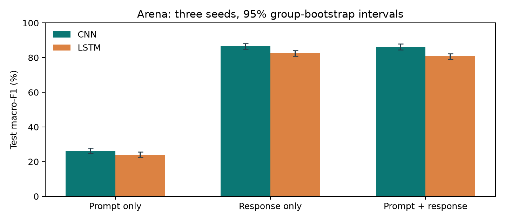
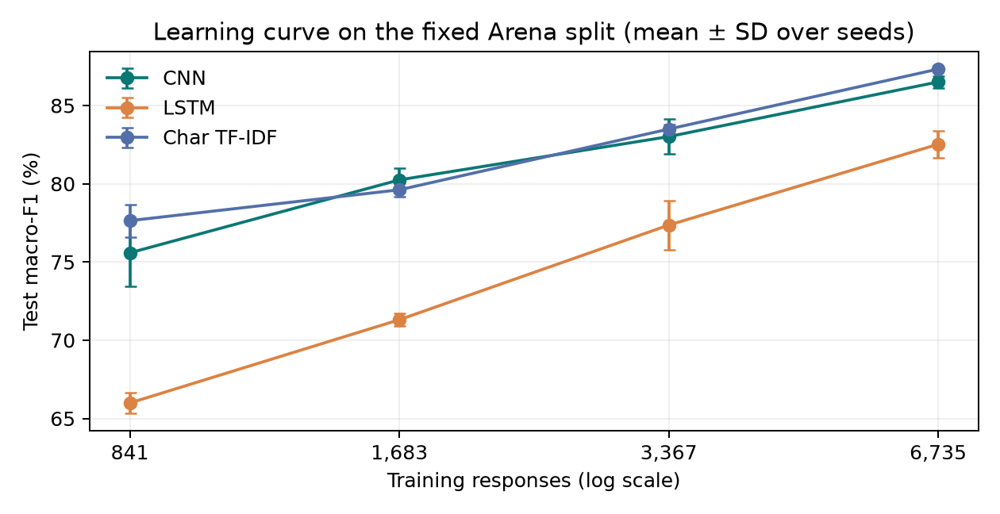

# Who Wrote It?

### Identifying LLMs from Their Responses

**Haodong Huang · CMPSC 448 · Individual midterm project**

## [Read the Project Report (PDF)](report/Who_Wrote_It_Haodong_Huang.pdf)

The main study now uses **Arena Human Preference 140k**: **9,643 curated English, single-turn responses** from four specific model releases. Required CNN and RNN/LSTM models are trained, selected on validation data, and evaluated across three seeds.



## Main results

Means across seeds 1448, 1449, and 1450 on the same 1,466-response test split. Macro-F1 is the primary metric; per-class recall, seed variation, and group-bootstrap intervals are in the report.

| Model | Input | Accuracy | Macro-F1 | Balanced accuracy |
|---|---|---:|---:|---:|
| CNN | input | 26.94% | 26.31% | 26.69% |
| CNN | output | 86.79% | 86.51% | 86.49% |
| CNN | combined | 86.54% | 86.18% | 86.22% |
| LSTM | input | 25.15% | 24.06% | 25.25% |
| LSTM | output | 83.04% | 82.52% | 82.63% |
| LSTM | combined | 81.20% | 80.79% | 80.95% |

The character TF-IDF baseline scores **87.65% accuracy / 87.33% macro-F1**. Its point estimate is slightly higher than the CNN mean; it is retained as a strong, inexpensive comparator.

The majority-class accuracy is **28.72%**. Uniform random accuracy and constant-class balanced accuracy are 25%. Prompt-only macro-F1 is not mathematically fixed at 25% in this unpaired four-source subset.

## Follow-up experiments (after the main evaluation)

Run after the frozen main study, under plans recorded before the runs in `docs/arena_followup_plan.json` and `docs/arena_followup_domain_plan.json`; no setting was chosen with test labels. Report Section 11 has details.

| Question | Finding |
|---|---|
| Does more training data help? | CNN macro-F1 75.59% → 86.51% and LSTM 65.99% → 82.52% going from 841 to 6,735 training responses (fixed split). |
| Is it just length? | With every answer cut to exactly 128 tokens: CNN 81.86%, LSTM 82.06% macro-F1. |
| Same prompt, two authors? | On 76 identical-prompt test pairs the CNN assigns both authors correctly 99.12% of the time; prompt-only is exactly 50%. |
| Where is the fingerprint? | Opening window ≫ middle; CNN keys on openers like "Certainly! Here's" (GPT), "Below is a detailed" (Grok), "I'd recommend" (Claude), bold numbered headers and "Would you like" (DeepSeek). |
| Transfer to unseen task types (RQ3, 3 seeds)? | Trained without coding, CNN macro-F1 on coding is 73.42% vs. 81.15% with matched mixed training; trained without creative writing (the assignment's example), 75.41% vs. 79.08% on writing. |
| Ensemble? | Equal-weight CNN+LSTM+char TF-IDF: 89.48% macro-F1 (+2.15 pp over char TF-IDF); with validation-chosen weights, 88.47%. |



## What data are actually used?

| Label | Exact model ID | Retained responses |
|---|---|---:|
| Claude | `claude-sonnet-4-20250514` | 2,774 |
| GPT | `gpt-4.1-2025-04-14` | 2,388 |
| Grok | `grok-3-preview-02-24` | 2,201 |
| DeepSeek | `deepseek-v3-0324` | 2,280 |

Source: [Arena dataset](https://huggingface.co/datasets/lmarena-ai/arena-human-preference-140k), pinned revision `6322995ab34d7c2693e3f47dd13fa5caa0789a74`. The complete release has 135,634 battles from April-July 2025. The four selected IDs contribute 26,992 sides before filtering. We retain all eligible English, first-evaluation, strict single-turn text answers after length, sensitive-pattern, and duplicate checks. Complete model IDs and family names are masked.

The target is **four fixed releases**, not every member of their families or the latest 2026 models. User prompts are CC-BY-4.0; the source card notes separate provider terms for model outputs. Raw conversations are neither committed nor reproduced in the report.

## Experimental controls

- Train / validation / test: **6,735 / 1,442 / 1,466** responses. Sessions, exact/near-duplicate prompts, and exact repeated answers cannot cross splits.
- Training-only vocabularies, TF-IDF, scalers, and inverse-frequency class weights.
- Four validation-screen candidates; selected CNN/LSTM recipes repeated across all three input conditions and three seeds.
- **RQ1:** response-only author classification. **RQ2:** prompt vs. response vs. combined input.
- **RQ3:** train without a task type and test on it (coding; creative writing), each against a mixed-domain control matched by per-class training count; three seeds in the follow-up.
- **RQ4:** six lexical/structural baselines and neural word-only normalization ablations.
- Shuffled-training-label CNN negative control; independent validation/test rescoring and saved-model replay.

The current study contains **27 neural fits + 6 classical fits**, with **31 test prediction files**. Rejected screen candidates have no test scores. [Complete run ledger](results/arena/run_ledger.csv) · [Verification](results/arena/verification.json)

## Reproduce

Use Python 3.12. Create a virtual environment and install the pinned dependencies:

```sh
python3 -m venv .venv
source .venv/bin/activate
python -m pip install -r requirements-lock.txt
python src/arena_data.py download
python src/arena_data.py prepare
python src/arena_train.py train
python src/arena_train.py domain
python src/arena_train.py evaluate
python src/arena_analyze.py
python src/arena_followup.py plan
python src/arena_followup.py posthoc
python src/arena_followup.py curve
python src/arena_followup.py domain
python -m unittest discover -s tests -v
python src/build_lessons_figures.py
python src/build_report.py
python src/build_readme.py
```

Reproduce in a fresh clone. `prepare` validates the published manifest and refuses to overwrite existing split text. The roughly 1.61 GB download and full training checkpoints stay local. Retained final-study fit/validation time was 12.5 minutes on the original machine, excluding downloading, curation, analysis, reporting, and superseded development fits. Different hardware may take longer and produce slightly different results. See [reproducibility details](docs/REPRODUCIBILITY.md).

## Demonstrate a saved model

```sh
python src/predict.py --response 'Your example answer goes here.'
python src/predict.py --checkpoint models/arena_lstm_output_s1448.pt --response 'Your example answer goes here.'
```

Scores are **uncalibrated closed-set outputs**, not reliable probabilities of authorship for arbitrary text. The supplied CNN and LSTM examples use seed 1448; reported main results average three separately trained models, not the demonstration alone.

## Interpret the results carefully

Arena does not give every prompt to all four selected models. Language, generation settings, task mix, and platform conventions can affect attribution. The prompt-only control measures some of that risk. The CNN reads 384 answer tokens; LSTM reads 192, so their comparison concerns complete recipes rather than architecture in isolation. Normalization also changes token composition and truncation. Test-group intervals condition on fitted models and do not capture all training, selection, or distribution-shift uncertainty.

The test set was untouched by model training and selection before the reported evaluation. Any future tuning using these published test scores must be identified as follow-up work and needs a new test set for confirmation.

## Project evolution and dataset-change rationale

We changed datasets for two reasons: **(1) study the more recognizable Claude/GPT/Grok/DeepSeek model families; (2) increase the usable sample, hoping that more training evidence would improve accuracy.** This release contains 2025 data.

| Stage | Dataset / classes | Curated responses | CNN accuracy | LSTM accuracy |
|---|---|---:|---:|---:|
| Initial implementation | UltraFeedback / Falcon, GPT, Llama | 4,254 | 77.52% | 64.01% |
| Same-data optimization | Same UltraFeedback data and split | 4,254 | 80.91% | 77.00% |
| Current study | Arena / Claude, GPT, Grok, DeepSeek | 9,643 | 86.79% | 83.04% |

All scores are response-only, three-seed means within each stage. Same-data optimization increased CNN/LSTM accuracy by **3.39/12.99 percentage points**, but was exploratory follow-up on an already evaluated test set. Arena provides **2.27 times as many curated responses**, with explicit model-release selection, session/duplicate grouping, frozen validation selection, and matched-size domain controls. Its scores are **not directly comparable** to the earlier three-class task: author classes, distributions, and split designs changed. The follow-up learning curve on the fixed Arena split (report Section 11A) isolates training size: with the same recipes and test set, CNN macro-F1 rises from 75.59% with 841 training responses to 86.51% with 6,735.

## Repository guide

| Path | Purpose |
|---|---|
| `src/arena_data.py` | Pinned acquisition, filtering, grouping, and split generation |
| `src/arena_train.py` | Validation selection, core/diagnostic fitting, frozen test evaluation |
| `src/models_v2.py` | CNN and pooled LSTM, with explicit four-class output support |
| `src/arena_analyze.py` | Independent audits, grouped intervals, figures, and checkpoint replay |
| `src/arena_followup.py` | Follow-up: learning curve, length/position/matched-prompt diagnostics, ensemble, CNN n-grams, RQ3 extension |
| `results/arena_followup/` | Follow-up metrics and logs |
| `tests/` | Sixteen checks of leakage, attribution, padding, sequence handling, and follow-up subsetting |
| `results/arena/` | Complete metrics, validation probabilities, non-text test predictions |
| `docs/arena_*.json` | Data provenance, curation repair, plans, selection, and freeze records |
| `data/arena/split_manifest.json` | Non-text published split assignments |
| `models/arena_*.pt` | Two locally usable demonstration checkpoints |
| `report/` | Current report (PDF and text version) |

Course grounding: Chapter 4 (CNN/pooling/LSTM) and Chapter 9 (loss/mini-batches/Adam). Specific budgets, filters, and hyperparameters are project design decisions.
