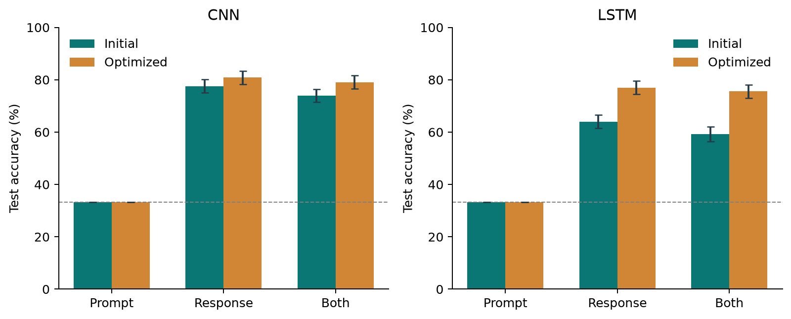

# Whose Slop Is It?

### Identifying LLM families under a matched-prompt evaluation

**Haodong Huang · CMPSC 448 · Individual midterm project**

A reproducible comparison of a text CNN and an LSTM **recurrent neural network (RNN)** on **1,418 matched prompts / 4,254 responses** from Falcon, GPT, and Llama. Matching the user prompt across all three families controls a common confound: learning which questions were asked of each model instead of recognizing the responses.

[Read the updated report](report/Whose_Slop_Is_It_Haodong_Huang.pdf) · [Editable report](report/report.md) · [中文讲解与答辩准备](docs/ORAL_DEFENSE_ZH.md)



## Optimized results

A bounded search selected configurations using validation metrics only. The selected CNN reads up to 384 response tokens; the selected LSTM uses masked mean + max pooling over 192 tokens. Both remain small, course-grounded networks. Three-seed test accuracy:

| Model | Initial response-only | Optimized response-only | Change |
|---|---:|---:|---:|
| CNN | 77.52% | **80.91 ± 1.08%** | +3.39 pp |
| LSTM | 64.01% | **77.00 ± 1.08%** | +12.99 pp |

Both paired 95% improvement intervals exclude zero on this follow-up split. The optimized prompt-gain intervals include zero: the slightly lower combined-input point estimates do not establish that adding prompts helps or hurts. The test split was previously seen in the initial study, so this is not a new blind test.

## Initial results (preserved)

Test accuracy, mean ± sample standard deviation over seeds 448, 449, 450. The same prompt-disjoint split is used throughout.

| Model | Prompt only | Response only | Prompt + response |
|---|---:|---:|---:|
| CNN | 33.33 ± 0.00% | **77.52 ± 0.86%** | 73.87 ± 0.98% |
| LSTM | 33.33 ± 0.00% | **64.01 ± 1.63%** | 59.21 ± 0.24% |

- Prompt-only accuracy is exactly one third by construction: every prompt appears once per family.
- Adding prompts lowers accuracy under the fixed recipe; paired cluster-bootstrap intervals exclude zero for both architectures.
- A TF-IDF + logistic regression baseline reaches 77.31% response-only accuracy, comparable to CNN.
- RQ4: structural feature probes and normalization/retraining test potential stylistic cues.
- RQ3: an exploratory held-out-source test uses equal-size training controls. Differences are uncertain; this is not proof of general domain robustness.
- The study concerns selected historical releases and this distribution, not arbitrary current LLMs or human authorship.

See `results/summary.json` for macro-F1, confidence intervals, contrasts, and all auxiliary results. The report includes all neural runs, limitations, references, and AI assistance disclosure.

## Environment

Tested with Python 3.12.13, PyTorch 2.14.1, macOS on Apple M4 Pro (24 GB), using MPS. A CPU fallback is automatic. Linux/CUDA has not been tested; the current runner chooses CPU rather than CUDA on non-MPS machines. Random seeds do not guarantee bitwise agreement across hardware or library versions.

Using [uv](https://docs.astral.sh/uv/):

```bash
uv venv --python 3.12 .venv
uv pip install --python .venv/bin/python -r requirements-lock.txt
```

Alternatively, create a Python 3.12 virtual environment and install `requirements-lock.txt` with pip.

## Reproduce the initial experiments

Run from this repository's root:

```bash
.venv/bin/python src/download_data.py
.venv/bin/python src/prepare_data.py
.venv/bin/python -m unittest discover -s tests -v
.venv/bin/python src/run_experiments.py
.venv/bin/python src/baselines.py
.venv/bin/python src/analyze.py
.venv/bin/python src/verify_results.py
```

`download_data.py` retrieves about 323 MB of pinned Parquet files and validates their SHA-256 hashes. The dataset is available without an API key. Download, processing, and training require additional local disk space. The script records immutable source URLs in `docs/data_provenance.json`.

The initial experiment runner executes 26 neural runs: 18 primary runs (2 architectures × 3 inputs × 3 seeds), 2 normalization runs, 4 source-shift/control runs, and 2 shuffled-label diagnostics. It skips a completed run **only if its metrics, predictions, and checkpoint all exist**. All non-text predictions and initial/optimized demonstration weights are included. Full training checkpoints remain local, so a fresh clone retrains the experiment matrix. To force rerunning a particular experiment, move that experiment's JSON result aside first. Aggregate results in the published repository are a snapshot of the reported experiment; rerunning can overwrite them.

After environment setup and data reconstruction, run `src/verify_results.py` without retraining to recompute all 31 published metrics and replay the included CNN. Non-text prediction files contain hashes, labels, source categories, and probabilities, never original prompt/response text.

Classical baselines add 5 runs. Two validation-only pilots were used to measure runtime; they do not contribute test results. The main plan was fixed before neural evaluation; shuffled-label controls were added as post hoc diagnostics and documented separately. No test-based hyperparameter search was performed.

To run one condition:

```bash
.venv/bin/python src/train.py --model cnn --mode output --seed 448
.venv/bin/python src/train.py --model lstm --mode combined --seed 448
```

To demonstrate the optimized response-only CNN checkpoint (no retraining needed):

```bash
.venv/bin/python src/predict.py --response "Photosynthesis converts light energy into chemical energy in plants."
```

The printed probabilities are uncalibrated model outputs, not reliable forensic confidence.

## Reproduce the optimization stage

After reconstructing the data and initial results, run:

```bash
.venv/bin/python src/iterate.py search
.venv/bin/python src/iterate.py confirm
.venv/bin/python src/iterate.py evaluate
.venv/bin/python src/analyze_v2.py
.venv/bin/python src/verify_v2.py
.venv/bin/python src/build_report.py
```

`search` trains only on train/validation data. It screens 12 candidates at seed 448, repeats the top two per architecture with seeds 449/450, then freezes the best mean validation macro-F1 selection. `confirm` fills in the input-only and combined conditions. `evaluate` requires all 18 selected runs to be fitted before it loads the test split. It does not evaluate rejected candidates on test. Frozen selections are checked on reruns: cross-platform changes that choose a different winner require a separate experiment directory rather than silently replacing the reported selection.

The v2 models compare last-state versus masked mean/max pooling, single versus bidirectional recurrence, 192 versus 384 response tokens, embedding/hidden sizes, learning rates, and normalization. The bidirectional implementation is numerically checked against a packed PyTorch LSTM. Full candidate details and all seed results are retained in `docs/iteration_plan.json`, `docs/iteration_selection.json`, and `results/v2/run_ledger.csv`.

The previously published test split is reused for follow-up evaluation. Configurations are selected solely on validation performance, but this is **not a fresh blind test**. The old test results motivated iteration, and selection among candidates can overfit validation. Original RQ3/RQ4 findings apply to the initial networks only. No global-optimum or state-of-the-art claim is made.

[中文优化说明](docs/ITERATION_NOTES_ZH.md) · [Initial report archive](report/archive/Who_Wrote_It_Haodong_Huang_v1.pdf)

## Data and controls

Source: [OpenBMB/UltraFeedback](https://huggingface.co/datasets/openbmb/UltraFeedback). Exact original and converted-data revisions, checksums, and acquisition metadata appear in `docs/data_provenance.json`. The dataset card labels the release MIT; upstream source terms also apply. Raw data and response text are not redistributed here.

- Families: Falcon-40B-Instruct; GPT-3.5/GPT-4; Llama-2-7B/13B/70B-Chat.
- One seeded response per family for each eligible prompt; no quality-based selection.
- ShareGPT records are excluded; a narrow email/key-pattern filter removes five additional complete prompts. This is not a comprehensive privacy audit.
- Prompt clusters remain disjoint across train/validation/test, including detected near duplicates and long exact shared responses.
- Splits contain 992 / 213 / 213 prompts; each contains exactly equal family counts.
- Identity names are replaced with a common marker. Only text enters predictive models.
- Predictive vocabularies/scalers are fitted on training data only.
- All neural checkpoints are chosen using validation macro-F1, with validation loss as tie-breaker.
- Combined inputs reserve separate prompt and response budgets.
- Tests check padding invariance, grouped splitting, balance, vocabulary leakage, and response preservation.
- `verify_results.py` recomputes 31 metric sets from predictions and replays a saved checkpoint.

## Files

| Path | Purpose |
|---|---|
| `src/prepare_data.py` | Matched-prompt construction, filtering, duplication controls, splitting |
| `src/models.py` | CNN and LSTM implementations |
| `src/train.py` | Initial training, validation selection, evaluation, checkpointing |
| `src/models_v2.py`; `src/iterate.py` | Optimization models and validation-only selection protocol |
| `src/analyze_v2.py`; `src/verify_v2.py` | Follow-up comparisons and independent result audit |
| `src/run_experiments.py` | Fixed experiment matrix and restart handling |
| `src/baselines.py` | TF-IDF and structural baselines |
| `src/analyze.py` | Grouped bootstrap, paired contrasts, figures |
| `src/verify_results.py` | Metric and checkpoint verification |
| `src/build_report.py` | Rebuild PDF and editable Markdown from measured results |
| `tests/` | Experimental-integrity tests |
| `models/` | Initial and optimized seed-448 response-only CNN/LSTM weights |
| `data/processed/split_manifest.json` | Non-text IDs, labels, versions, and fixed split assignments |
| `results/` | Metrics, logs, audit, and figures |
| `report/` | PDF report and Markdown counterpart |

The supplied lecture and assignment PDFs stay local and are excluded from version control. Course grounding: Chapter 4 (convolution/pooling and LSTM), Chapter 9 (loss functions, mini-batches, and Adam). Implementation choices such as vocabulary size and token budgets are project decisions, not claims about prescribed course settings.

## Interpretation limits and assistance

Generation principles and custom system prompts can influence response style even though their metadata are not used as features. Matching user prompts does not remove this confound. Version coverage, shared-prompt selection, truncation, a single split, and a short fixed training budget limit generalization. Auxiliary neural experiments use one seed. Cluster-bootstrap intervals condition on fitted models and are not adjusted for multiple exploratory comparisons.

ChatGPT assisted with design, code, debugging, analysis, and drafting. Metrics are from actual local executions. The student remains responsible for reviewing, understanding, and explaining the work.
