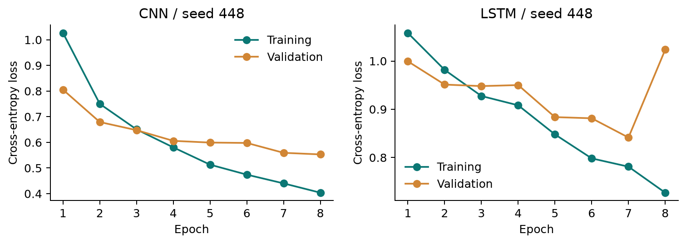
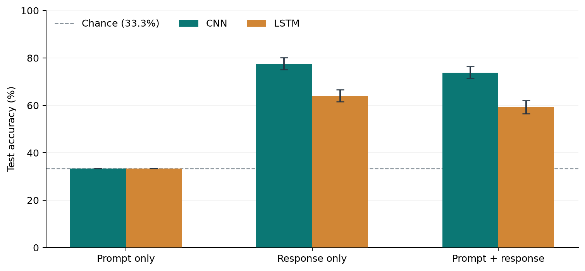
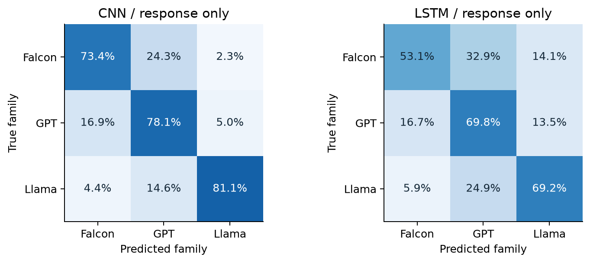
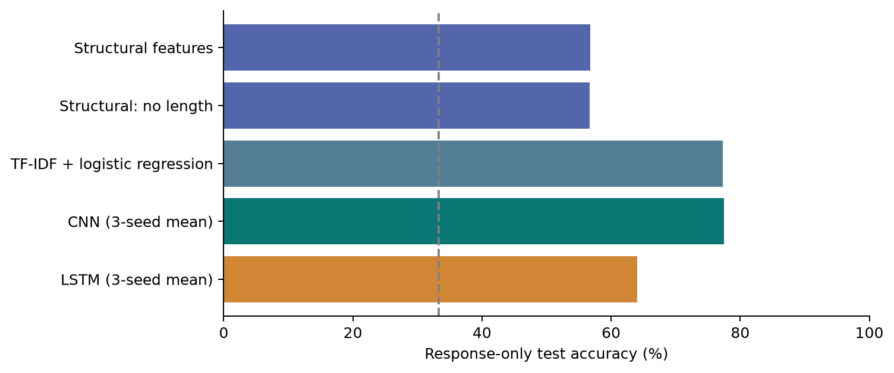
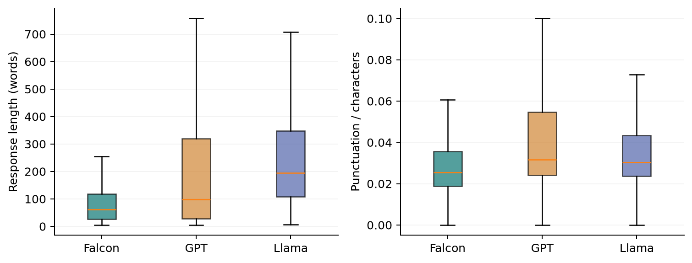
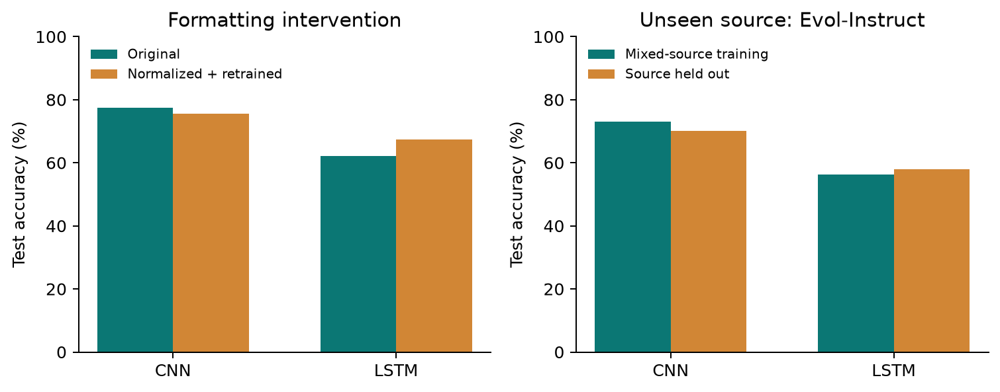

# Who Wrote It?

Identifying LLMs from Their Responses

Haodong Huang | Individual projectCMPSC 448 | October 10, 2026

### Abstract

This project compares a text CNN and an LSTM recurrent neural network (RNN) for identifying Falcon, GPT, and Llama responses. A curated UltraFeedback subset contains 1,418 shared prompts and 4,254 responses. Each prompt appears once per family; near-duplicate prompt groups remain within a single data split. Model-name tokens are masked, and no model metadata enter the classifiers. Initial response-only accuracies are 77.5% (CNN) and 64.0% (LSTM). A bounded validation-only search subsequently yields 80.9% and 77.0% across three seeds. All configurations are chosen before follow-up test evaluation. Prompt-only accuracy is exactly 33.3% by construction. Both initial and optimized input comparisons are reported. Structural baselines, normalization, and a source-holdout experiment test alternative explanations. These are results for selected historical models and this curated distribution, not a universal detector of contemporary LLMs.

### Main findings

| Question | Evidence and answer |
| --- | --- |
| RQ1: Can responses identify a family? | Optimized CNN: 80.9%; optimized LSTM: 77.0%; chance: 33.3%. |
| RQ2: Does the prompt help? | Optimized combined-minus-response change: CNN -1.83 pp; LSTM -1.36 pp. Both intervals include zero. |
| RQ3: Transfer across sources? | Initial-model probe: both exceed chance on a held-out source; differences from matched-size controls are uncertain. |
| RQ4: What signals matter? | Initial-model probes: structural features predict above chance; formatting effects depend on the model and training recipe. |

Scope: 26 initial neural runs, 5 classical baselines, 32 optimization-stage fits (18 evaluated on test), 2 validation-only timing pilots, and 2,000 cluster-bootstrap resamples. The follow-up reuses the previously reported split; it is not a fresh blind test.

## 1. Dataset and problem definition

The target is a three-way family label, not response quality or whether the author is human. UltraFeedback stores an instruction and multiple model-tagged completions [1,2]. The source artifacts are pinned by revision and SHA-256 hash. Only instruction text and response text become features; ratings, critiques, model names, source labels, and system prompts are excluded from predictive inputs.

| Family label | Eligible generator identifiers | Selection per prompt |
| --- | --- | --- |
| Falcon | falcon-40b-instruct | One response |
| GPT | gpt-3.5-turbo; gpt-4 | One eligible response, seeded choice |
| Llama | llama-2-7b-chat; llama-2-13b-chat; llama-2-70b-chat | One eligible response, seeded choice |

If a prompt has multiple eligible responses within a family, a deterministic prompt-specific random choice selects one. Quality scores never guide selection. Llama-derived models such as Vicuna and WizardLM are not mixed into the chosen Llama label. Falcon has one version while GPT and Llama pool multiple versions; this asymmetry limits family-level conclusions.

| Curation step | Prompt records |
| --- | --- |
| Original records scanned | 63,967 |
| Excluded ShareGPT source (real-user chat) | 19,949 |
| Excluded: no complete three-family set with usable answers | 42,595 |
| Excluded: email or API-key-like pattern | 5 |
| Final complete matched prompts | 1,418 |
| Final response-level examples | 4,254 |

Usable answers contain at least five whitespace-separated words. Prompts must contain at least three words. Screening is narrow and is not a comprehensive privacy guarantee. Raw and processed text stay out of the public submission bundle; reconstruction scripts and provenance are provided. The dataset card labels the release MIT; upstream source conditions still matter [1].

| Split | Prompts | Responses | Each family |
| --- | --- | --- | --- |
| Train | 992 | 2,976 | 992 |
| Validation | 213 | 639 | 213 |
| Test | 213 | 639 | 213 |

Training, validation, and test proportions are approximately 70/15/15. Seed 448 fixes data construction and splitting. All 1,418 eligible prompts are used; the preconfigured cap of 1,500 is not reached.

## 2. Leakage controls and the prompt-only test

### Keep dependent observations together

Prompts are normalized with Unicode NFKC, lowercase, and collapsed whitespace for identity checks. Character 3-5-gram TF-IDF cosine similarity of at least 0.90 links near duplicates. Connected components define split groups. This detects 7 similar prompt pairs and produces 1,411 clusters. Long exact shared responses (at least ten words) also link their prompts before splitting. The resulting groups are disjoint across all splits.

Duplicate detection uses the full unlabeled prompt collection solely to protect the split. This is not the predictive vocabulary: that vocabulary is fitted on training text only. A fixed threshold catches obvious near copies, not all semantic paraphrases.

### Remove easy label cues

Explicit names such as GPT, OpenAI, Llama, Meta, Falcon, and TII are replaced with the same [MODEL] token in prompts and responses. This affects 30 responses. It prevents direct name lookup but can still preserve cues that an identity was mentioned. Broad masking can also remove legitimate topic words; this is a documented preprocessing tradeoff.

### Why 33.3% is exact here

Every held-out prompt has three identical input texts, one carrying each family label. A deterministic prompt-only classifier must predict the same family for those three rows, so it gets exactly one correct. Its accuracy is therefore 1/3, regardless of which family it chooses. This is a deliberate negative control, not a claim that prompts are always uninformative in natural user traffic. Macro-F1 can differ because predicted family frequencies differ.

### Remaining generation confound

UltraFeedback varies instruction principles and custom system prompts during generation [1]. We do not feed these fields to the classifier, but their effects remain in the generated answer. Matching the user prompt does not make the full generation conditions identical. Consequently, learned signals can reflect the generation protocol as well as model identity.

| Generation principle | Falcon | GPT | Llama |
| --- | --- | --- | --- |
| helpfulness | 958 | 899 | 965 |
| honesty | 127 | 125 | 120 |
| truthfulness | 136 | 205 | 137 |
| verbalized_calibration | 197 | 189 | 196 |

Automated checks verify split disjointness, one response per family per prompt, train-only vocabulary construction, preserved response budget in combined inputs, and prediction invariance to extra padding.

## 3. Initial models and training procedure

The CNN follows the course treatment of convolution and pooling, adapted to a one-dimensional token sequence (Chapter 4, especially p. 36). LSTM fulfills the required RNN model; it follows the course LSTM material (Chapter 4, pp. 69-79). Mini-batch optimization and Adam follow Chapter 9, pp. 41-48 and 62-65 [3,4]. PyTorch supplies the differentiable layers and optimizer [5].

| Component | Text CNN | Text LSTM |
| --- | --- | --- |
| Token representation | Trainable 64-dimensional embeddings | Trainable 64-dimensional embeddings |
| Sequence processing | 64 filters for each width 3, 4, 5; ReLU | One unidirectional layer; 64 hidden units |
| Sequence summary | Masked global max pooling; 192 features | Hidden state at the final real token |
| Prediction | Dropout 0.30; linear layer; 3 logits | Dropout 0.30; linear layer; 3 logits |
| Output-only parameter count | 795,459 | 779,011 |

Text is lowercased and split into word and punctuation tokens; newline markers preserve layout. The vocabulary keeps training tokens occurring at least twice, capped at 12,000 entries including reserved tokens. Unknown tokens map to UNK and PAD has embedding index zero. Input-only uses up to 96 tokens; output-only uses up to 192. Combined input reserves 96 prompt tokens, a separator, and 192 response tokens, so a long prompt cannot eliminate the answer.

Training minimizes multiclass cross-entropy: L = -(1/B) sum log p(correct family | text). Settings: batch size 64, Adam learning rate 0.001, weight decay 0.0001, gradient norm clip 1.0, maximum 8 epochs, and patience 3. The selected checkpoint maximizes validation macro-F1; ties favor lower validation loss. Test performance is computed only after checkpoint selection. No hyperparameter sweep is performed.

Primary seeds are 448, 449, and 450, with a fixed split. Auxiliary runs use seed 448. Python, NumPy, PyTorch, and the data-loader generator are seeded. Hardware: Apple M4 Pro, 24 GB memory, MPS backend. MPS numerical behavior is not guaranteed bitwise identical across systems.

Figure 1. Response-only learning curves for the predesignated seed 448; all runs and checkpoints are retained.

## 4. Initial experiments: RQ1 and RQ2

The six initial conditions share the same examples and split. Accuracy and macro-F1 are reported as mean plus/minus sample standard deviation across three training seeds. Intervals resample near-duplicate clusters, carrying all matched answers together, and average the metric over the same three fitted models. They quantify held-out-sample uncertainty conditional on these runs, not uncertainty over all datasets or all possible training seeds.

| Model | Input | Accuracy (%) | Macro-F1 (%) | 95% accuracy CI |
| --- | --- | --- | --- | --- |
| CNN | Prompt | 33.33 +/- 0.00 | 28.28 +/- 2.95 | [33.33, 33.33] |
| CNN | Response | 77.52 +/- 0.86 | 77.79 +/- 0.95 | [75.07, 80.08] |
| CNN | Both | 73.87 +/- 0.98 | 74.17 +/- 1.10 | [71.47, 76.42] |
| LSTM | Prompt | 33.33 +/- 0.00 | 33.14 +/- 0.04 | [33.33, 33.33] |
| LSTM | Response | 64.01 +/- 1.63 | 63.97 +/- 1.45 | [61.50, 66.56] |
| LSTM | Both | 59.21 +/- 0.24 | 59.21 +/- 0.27 | [56.49, 62.13] |

Figure 2. Three-seed mean accuracy with 95% cluster-bootstrap intervals. The prompt-only interval collapses by design.

RQ1: Both response-only networks identify families above chance. CNN reaches 77.5% versus 64.0% for LSTM under this recipe. This comparison does not establish that CNNs always dominate RNNs.

RQ2: Adding the prompt changes CNN accuracy by -3.65 percentage points; paired 95% CI [-5.58, -1.82]; for LSTM the change is -4.80 percentage points; paired 95% CI [-7.09, -2.41]. Both intervals exclude zero. Irrelevant prompt variation and limited model capacity are plausible explanations, not isolated causal findings. Combined models retain the same 192-token answer budget.

## 5. Initial-model errors and family variation

Figure 3. Response-only confusion matrices, row-normalized after averaging counts across three seeds. Each family has 213 held-out responses.

The confusion matrices show which families are mistaken for each other rather than reducing the experiment to one accuracy number. A family-level success rate can hide substantial variation among its underlying model versions. The following diagnostic uses seed 448, designated before testing; it does not select the best seed.

| Generator version | Test responses | Correct family prediction |
| --- | --- | --- |
| falcon-40b-instruct | 213 | 78.9% |
| gpt-3.5-turbo | 106 | 73.6% |
| gpt-4 | 107 | 70.1% |
| llama-2-13b-chat | 80 | 90.0% |
| llama-2-70b-chat | 76 | 69.7% |
| llama-2-7b-chat | 57 | 86.0% |

These are per-version recalls for the family classifier, not version-identification accuracies. The models have not learned separate labels for GPT-4 and GPT-3.5, for example. Unequal sample counts and varying task mixes mean the version differences are descriptive; they should not be interpreted as a ranking of writing quality or model capability.

Truncation is substantial: 38.3% of test responses exceed 192 tokens, and 45.1% of test prompts exceed 96 tokens. Predictions therefore concern bounded prefixes. The CNN can capture local patterns anywhere within its retained prefix; a final-state LSTM must summarize that prefix in 64 hidden units. This is a plausible source of the architectural gap, but a pooling or bidirectional-LSTM ablation would be needed to test it.

## 6. Initial baselines and negative controls

A TF-IDF + logistic regression baseline uses the same truncated tokens as the neural models, with unigram/bigram features, sublinear term frequency, minimum document frequency 2, at most 30,000 features, C = 1, and 1,000 maximum iterations. Training-only features prevent vocabulary leakage. This checks whether a simple sparse classifier is already competitive.

Figure 4. Simple baselines versus the required response-only networks. Neural bars average three seeds; classical baselines are single fixed runs.

| Baseline | Accuracy | Macro-F1 |
| --- | --- | --- |
| TF-IDF: prompt | 33.3% | 16.7% |
| TF-IDF: response | 77.3% | 77.4% |
| TF-IDF: both | 75.1% | 75.2% |
| Structural features | 56.8% | 55.8% |
| Structural: remove length | 56.7% | 55.7% |

TF-IDF response-only accuracy is 77.3%, close to the CNN mean. There is no basis here to claim that neural complexity is necessary. Learning discriminative lexical patterns is already effective on this small historical benchmark.

### Shuffled-label diagnostic

An additional post hoc diagnostic permutes training labels while preserving validation/test labels and all settings. CNN accuracy falls to 26.4% and LSTM to 29.6%. These particular runs are below chance, not exactly at chance. They show that corrupted supervision does not retain useful above-chance performance; one permutation does not prove that every form of leakage has been excluded. This diagnostic was not used to tune or replace the primary results.

## 7. RQ4: initial-model signal probes

The structural baseline uses ten features: log character count, log word count, mean word length, lexical diversity, newline rate, punctuation rate, digit rate, uppercase rate, list-line rate, and code-fence count. Standardization is fitted only on training examples. This baseline sees full responses, unlike the prefix-limited text classifiers, so it is an exploratory signal probe rather than an equal-information leaderboard.

Figure 5. Full-response structural distributions across the curated corpus. Box plots omit outliers visually, not from calculations.

The structural classifier reaches 56.8%. Removing the two explicit length features changes accuracy by -0.16 percentage points; paired 95% CI [-2.03, 1.72]. Other features can still correlate with length, so this does not prove length is irrelevant. It does show that explicit length counts alone are not necessary for this feature set to perform above chance.

### Remove punctuation and newline markers, then retrain

| Model (seed 448) | Original accuracy | Normalized accuracy | Change (pp) |
| --- | --- | --- | --- |
| CNN | 77.5% | 75.6% | -1.88 |
| LSTM | 62.1% | 67.4% | +5.32 |

CNN change: -1.88 percentage points; paired 95% CI [-5.16, 1.25]. LSTM change: +5.32 percentage points; paired 95% CI [1.26, 9.39]. The CNN interval overlaps zero; the LSTM improvement is positive for this seed. Thus formatting cues are not uniformly beneficial across architectures.

Normalization retains lowercase word tokens and removes punctuation/newline tokens. It also changes token boundaries and allows more words inside the fixed token limit. The intervention bundles formatting removal with altered effective context; it cannot isolate a pure causal effect of punctuation. Auxiliary results use one seed and should be repeated before strong claims.

## 8. RQ3: initial-model source transfer

This exploratory experiment holds out Evol-Instruct from training and validation and evaluates on its original test prompts. Source identity is a proxy for distribution shift, not a clean coding-versus-writing task label. The 58 test prompts (174 responses) are identical for both conditions. A mixed-source control randomly subsamples the original training prompts to match the holdout training size.

| Condition | Train rows | Validation rows | Test rows |
| --- | --- | --- | --- |
| Evol-Instruct excluded | 2,175 | 441 | 174 |
| Mixed-source, same size | 2,175 | 441 | 174 |

Figure 6. Auxiliary interventions, seed 448. Left: normalization and retraining. Right: equal-size training controls on the same held-out-source test subset.

| Architecture | Mixed source | Source held out | Difference (pp) |
| --- | --- | --- | --- |
| CNN | 73.0% | 70.1% | -2.87 |
| LSTM | 56.3% | 58.0% | +1.72 |

CNN shift effect: -2.87 percentage points; paired 95% CI [-7.47, 1.15]. LSTM shift effect: +1.72 percentage points; paired 95% CI [-5.76, 8.62]. Both intervals include zero. Each held-out-source classifier remains above chance, but the experiment does not provide clear evidence of either a deterioration or an improvement relative to the equal-size control.

Holding training size constant reduces a simple data-volume confound. It does not make the two training distributions otherwise identical. The validation distribution excludes Evol-Instruct for both conditions. Only one source, one split, and one training seed are examined; the test contains only 58 prompts. Stronger domain-generalization claims would require explicit task annotation, more held-out domains, and repeated runs.

## 9. Reproducibility, limitations, and lessons

### Reproduce the results

Create a Python 3.12 environment and install requirements-lock.txt. First run the download and preparation scripts, tests, initial experiment runner, baselines, and initial analysis. Then run src/iterate.py with search, confirm, and evaluate in that order, followed by analyze_v2.py, both verification scripts, and build_report.py. The README contains exact commands. The experiment runner resumes completed runs; a fresh result directory is required for a complete retraining. Every neural result records its settings, selected epoch, vocabulary size, parameter count, history, device, runtime, and split-manifest hash.

Recorded fitting and validation time summed across the initial neural runs and classical baselines is 90.3 seconds. This excludes process startup, downloads, data preparation, report generation, and the timing pilots. The small networks and short sequences make fitting fast; data curation and analysis remain essential work.

### Practical lessons supported by the experiments

Evaluation design can matter more than an extra model layer. Matched prompts turn an ambiguous input-only experiment into an exact negative control. Grouped splitting prevents related answers from entering both train and test.

More input is not automatically better. Both initial architectures lose accuracy after adding prompts under the fixed recipe; the optimized comparison is reported separately. Keeping the answer budget unchanged makes this comparison easier to interpret.

A strong baseline improves the conclusion. TF-IDF is competitive with CNN, while structural features alone predict above chance. These findings constrain what can be claimed about learned LLM fingerprints.

Uncertain and negative findings belong in the report. The source-shift intervals overlap zero, and normalization benefits one architecture. Reporting those results is more informative than selecting only favorable experiments.

### Boundaries of the evidence

The labels describe selected historical releases rather than current hosted systems or unseen families. Common-prompt availability creates a selected subset. Custom system prompts and generation principles remain confounds. Near-duplicate detection is incomplete. Short prefixes, small models, fixed budgets (initially 8 epochs, then up to 24), one split, and three primary seeds restrict conclusions. Bootstrap intervals are conditional on fitted models and assume clusters are approximately independent; they are not corrected for multiple exploratory comparisons. The optimization stage is a post hoc follow-up using the same test split, and validation performance is optimistic after model selection. The study is not suitable for accusing an individual author of using a particular AI system.

### AI assistance disclosure

ChatGPT assisted with experiment design, implementation, debugging, analysis, and report drafting. All reported metrics come from locally executed scripts and saved predictions, not invented examples. Automated checks cover important data and model invariants. Haodong Huang is responsible for reviewing, understanding, and explaining the submitted work, as required by the assignment [6].

## 10. Optimization: select using validation only

The initial model comparison prompted a bounded follow-up, rather than an open-ended attempt to maximize the test score. Before fitting, docs/iteration_plan.json fixed twelve candidates. Each used output-only training and seed 448. The top two candidates per architecture were repeated with seeds 449 and 450; the winner maximized mean validation macro-F1. Selection was saved and hashed before fitting the other input conditions or evaluating any optimized test predictions.

All candidates use Adam, weight decay 0.0001, batch size 64, gradient clipping 1.0, at most 24 epochs, and validation patience 5. They add embedding dropout 0.10 and allow up to 16,000 training-only vocabulary entries. The search changes multiple settings, so improvement over the initial recipe cannot be attributed to one isolated factor.

| ID | Structure / dimensions / tokens | Limit | LR | Val. F1 (448) |
| --- | --- | --- | --- | --- |
| c01 | CNN; e64/h64; raw | 192 | 0.001 | 80.5% |
| c02 * | CNN; e64/h64; raw | 384 | 0.001 | 80.7% |
| c03 | CNN; e128/h96; raw | 192 | 0.0007 | 78.9% |
| c04 | CNN; e128/h96; raw | 384 | 0.0007 | 83.0% |
| r01 | LSTM last; e64/h64; raw | 192 | 0.001 | 69.2% |
| r02 * | LSTM pool; e64/h64; raw | 192 | 0.001 | 81.4% |
| r03 | BiLSTM pool; e64/h64; raw | 192 | 0.001 | 79.5% |
| r04 | LSTM pool; e64/h64; words | 192 | 0.001 | 76.2% |
| r05 | BiLSTM pool; e64/h64; words | 192 | 0.001 | 75.5% |
| r06 | BiLSTM pool; e64/h64; raw | 384 | 0.001 | 79.2% |
| r07 | BiLSTM pool; e128/h96; raw | 384 | 0.0007 | 79.0% |
| r08 | LSTM pool; e64/h64; raw | 192 | 0.0005 | 79.4% |

e = embedding size; h = hidden units or CNN filters per kernel; pool = masked mean + max across valid positions; words = punctuation/newline removal. Asterisk marks the final three-seed validation winner, which need not be the seed-448 winner. Candidate details and all results are retained.

### Selected configurations

CNN c02: 384-token response budget, embedding 64, hidden/filter width 64, dropout 0.3, learning rate 0.001; pooling max, bidirectional not applicable. Mean validation macro-F1: 81.8%.

LSTM r02: 192-token response budget, embedding 64, hidden/filter width 64, dropout 0.3, learning rate 0.001; pooling meanmax, bidirectional False. Mean validation macro-F1: 79.9%.

The backward LSTM reverses only the valid token prefix. Its valid-position outputs were tested against a packed PyTorch bidirectional LSTM; extra padding and batch composition do not change predictions. These tests guard against a subtle source of invalid performance gains.

## 11. Optimized results and the limits of improvement

| Model | Input | Accuracy (%) | Macro-F1 (%) | 95% accuracy CI |
| --- | --- | --- | --- | --- |
| CNN | Prompt | 33.33 +/- 0.00 | 27.39 +/- 1.47 | [33.33, 33.33] |
| CNN | Response | 80.91 +/- 1.08 | 81.10 +/- 1.03 | [78.35, 83.36] |
| CNN | Both | 79.08 +/- 0.63 | 79.29 +/- 0.60 | [76.53, 81.60] |
| LSTM | Prompt | 33.33 +/- 0.00 | 31.30 +/- 1.96 | [33.33, 33.33] |
| LSTM | Response | 77.00 +/- 1.08 | 77.24 +/- 1.15 | [74.42, 79.67] |
| LSTM | Both | 75.64 +/- 2.04 | 75.90 +/- 2.00 | [73.03, 78.14] |

Figure 7. Initial versus optimized recipes on the same test split. Means over three seeds; intervals resample matched-prompt clusters.

CNN: response-only improvement is +3.39 percentage points (paired 95% CI [1.62, 5.16]). Within the optimized recipe, adding the prompt changes accuracy by -1.83 pp (CI [-3.86, 0.26]).

LSTM: response-only improvement is +12.99 percentage points (paired 95% CI [10.28, 15.99]). Within the optimized recipe, adding the prompt changes accuracy by -1.36 pp (CI [-3.58, 0.79]).

For both optimized architectures, the combined-minus-response intervals include zero. The lower point estimates therefore do not establish a clear benefit or harm from adding prompts under the optimized recipes.

Optimization used 32 fits and 458.5 seconds of recorded training/validation time; process startup and analysis are excluded. Only the six selected conditions across three seeds were evaluated on test. The full candidate/seed ledger is available as CSV.

These are improvements within a bounded search, not a global optimum or a state-of-the-art claim. All optimized choices used validation metrics, but the original test results motivated this follow-up, so this is not an untouched confirmatory test. The original source-shift and signal-removal findings concern the initial networks and are not automatically transferred to optimized models. A new independent dataset would strengthen the conclusions.

## Appendix A. Initial neural run ledger

All initial primary and auxiliary runs are listed; no unfavorable seed is omitted. The 32 optimization fits are listed separately in results/v2/run_ledger.csv. Values are test accuracy and macro-F1. Epoch is chosen on validation data. Timing pilots have no test score and are excluded.

| Model | Condition | Seed | Epoch | Acc. (%) | F1 (%) |
| --- | --- | --- | --- | --- | --- |
| CNN | input | 448 | 3 | 33.33 | 26.83 |
| CNN | input | 449 | 2 | 33.33 | 31.67 |
| CNN | input | 450 | 3 | 33.33 | 26.33 |
| CNN | output | 448 | 7 | 77.46 | 77.65 |
| CNN | output | 449 | 7 | 78.40 | 78.79 |
| CNN | output | 450 | 7 | 76.68 | 76.92 |
| CNN | combined | 448 | 7 | 74.18 | 74.53 |
| CNN | combined | 449 | 8 | 74.65 | 75.04 |
| CNN | combined | 450 | 7 | 72.77 | 72.94 |
| LSTM | input | 448 | 4 | 33.33 | 33.17 |
| LSTM | input | 449 | 1 | 33.33 | 33.16 |
| LSTM | input | 450 | 3 | 33.33 | 33.10 |
| LSTM | output | 448 | 7 | 62.13 | 62.30 |
| LSTM | output | 449 | 8 | 65.10 | 64.86 |
| LSTM | output | 450 | 8 | 64.79 | 64.76 |
| LSTM | combined | 448 | 7 | 59.15 | 59.10 |
| LSTM | combined | 449 | 7 | 59.47 | 59.51 |
| LSTM | combined | 450 | 7 | 59.00 | 59.01 |
| CNN | normalized | 448 | 8 | 75.59 | 76.01 |
| CNN | source held out | 448 | 7 | 70.11 | 69.73 |
| CNN | source control | 448 | 8 | 72.99 | 72.88 |
| CNN | shuffled labels | 448 | 6 | 26.45 | 23.06 |
| LSTM | normalized | 448 | 7 | 67.45 | 67.40 |
| LSTM | source held out | 448 | 7 | 58.05 | 58.21 |
| LSTM | source control | 448 | 8 | 56.32 | 56.49 |
| LSTM | shuffled labels | 448 | 1 | 29.58 | 29.75 |

Detailed class-wise metrics, losses, and confidence intervals are available in results/*.json and results/summary.json. The package includes aggregate metrics, non-text row-level predictions, and seed-448 response-only CNN/LSTM weights. Other checkpoints stay local and can be regenerated.

## Appendix B. References and submission contents

[1] OpenBMB. UltraFeedback dataset and dataset card.

https://huggingface.co/datasets/openbmb/UltraFeedback

[2] Cui, G., Yuan, L., Ding, N., et al. UltraFeedback: Boosting Language Models with Scaled AI Feedback. ICML 2024.

https://arxiv.org/abs/2310.01377

[3] CMPSC 448. Chapter 4: Deep Learning Architectures. Course slides supplied by the student.

CNN / pooling: pp. 16-41; 1D convolution: p. 36; RNN / LSTM: pp. 44-79.

[4] CMPSC 448. Chapter 9: ML Training--Gradient Descent. Course slides supplied by the student.

Mini-batch optimization: pp. 41-48; Adam: pp. 62-65.

[5] PyTorch documentation. Conv1d, LSTM, and Adam.

https://docs.pytorch.org/docs/stable/

[6] CMPSC 448. Who Wrote It? Identifying LLMs from Their Responses. Midterm project instructions, modified September 17, 2026.

Local assignment supplied by the student; deadline October 11, 2026, 11:59 pm.

### Immutable data provenance

Original dataset revision: 40b436560ca83a8dba36114c22ab3c66e43f6d5e

Converted Parquet revision: f5d499befd5cedca7d09ee86d2cbbd210a330798

Artifact hashes and download URLs are recorded in docs/data_provenance.json. The conversion revision is pinned separately from the dataset-card revision. Access and experiment date: October 10, 2026.

### Repository contents

| Path | Purpose |
| --- | --- |
| src/ | Data acquisition, curation, models, experiments, statistics, and report builder |
| tests/ | Checks that guard against leakage and padding errors |
| models/ | Initial and optimized CNN/LSTM demonstration weights (seed 448) |
| results/ | Initial and optimized metrics, non-text predictions, logs, and figures |
| docs/ | Provenance, experiment plan, and supplementary protocol |
| report/ | This PDF and editable Markdown source |
| README.md; requirements-lock.txt | Run instructions and exact dependency versions |

The repository intentionally excludes the source dataset, processed response text, lecture PDFs, assignment PDF, local environment, and additional model checkpoints. This keeps the submission compact and avoids republishing third-party course materials. Reproduction scripts recover the data from its original host.
