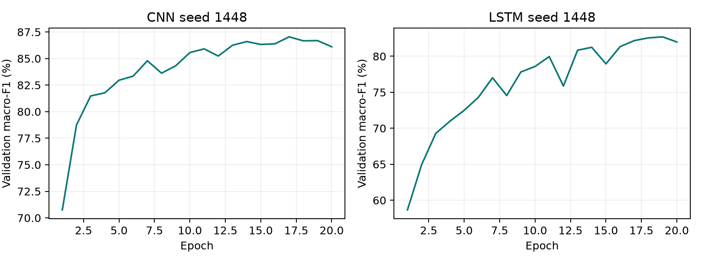
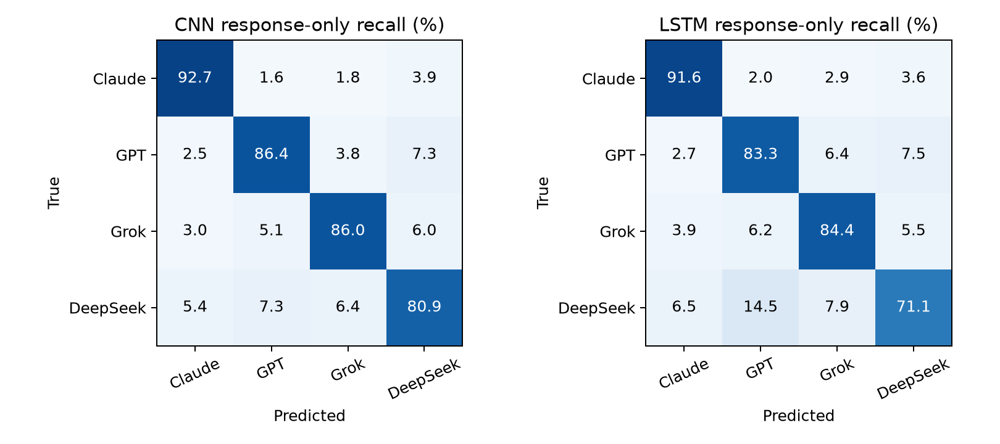
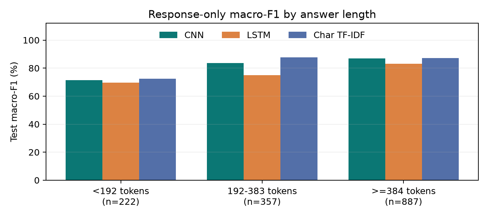

# Who Wrote It? Identifying LLMs from Their Responses

Identifying LLMs from Their Responses

Haodong Huang | Individual projectCMPSC 448 | October 10, 2026

### Abstract

This project identifies four LLM sources using a convolutional neural network (CNN) and an LSTM recurrent neural network (RNN). A pinned Arena Human Preference 140k release provides 9,643 curated English, single-turn responses from Claude Sonnet 4, GPT-4.1, Grok 3, and DeepSeek V3. Sessions, exact and near-duplicate prompts, and exact repeated answers remain within one split. Model identity tokens are masked. A four-candidate validation screen selects one CNN and one LSTM recipe, each evaluated on three random seeds and all three input conditions. Response-only macro-F1 is 86.5% for CNN and 82.5% for LSTM. Classical baselines, normalization ablations, shuffled labels, and a matched-size domain-transfer experiment probe what the models learn. These results concern four specific releases on a curated Arena distribution, not universal authorship attribution.

### Research questions and evidence

| Question | Evidence |
| --- | --- |
| RQ1: Identify the author? | CNN accuracy 86.8%; LSTM accuracy 83.0%. Macro-F1 and class recall accompany accuracy. |
| RQ2: Does the prompt help? | Combined-minus-output macro-F1: CNN -0.33 pp; LSTM -1.73 pp. Follow-up: on 76 identical-prompt pairs the CNN assigns both authors correctly 99.1% of the time. |
| RQ3: Transfer to coding? | Train on non-code and evaluate coding; compare with a mixed-domain control matched by training class counts. |
| RQ4: Which signals matter? | Word-only normalization, structural classifiers, equal-length inputs (CNN 81.9% F1 with length hidden), window position, and the n-grams the CNN relies on. |

Scope: 9,643 responses; four classes; 27 neural fits and 6 classical fits; 31 test prediction files; 2,000 group-bootstrap resamples. The earlier UltraFeedback study is preserved separately, not pooled into these scores. Section 11 adds follow-up experiments run after the main evaluation; they are reported separately and never replace main-study numbers.

## 1. Dataset and model provenance

The official Arena release contains 135,634 battles collected in April-July 2025 [1,2]. Each side provides a model ID and a conversation. We convert a retained side into (LLM_name, LLM_Input, LLM_output). Human preference votes are not author labels and never become input features. The source revision and seven file hashes are recorded in docs/arena_data_provenance.json.

| Class | Exact model ID | Before filters | Retained |
| --- | --- | --- | --- |
| Claude | claude-sonnet-4-20250514 | 8295 | 2774 |
| GPT | gpt-4.1-2025-04-14 | 6540 | 2388 |
| Grok | grok-3-preview-02-24 | 6040 | 2201 |
| DeepSeek | deepseek-v3-0324 | 6117 | 2280 |

One explicit, non-thinking model variant per family controls a major source of confounding. Grok 4 has only 1,561 sides in the complete release, whereas Grok 3 has 6,040; the study selects Grok 3 for sample support. Therefore class names are convenient abbreviations for these four fixed IDs. Later releases and alternative reasoning settings remain outside the measured scope.

### Curation sequence

| Rule | Reason |
| --- | --- |
| Exact four IDs; language=en | Keep the authorship target and language explicit. |
| evaluation_order=1; exactly user then assistant | Avoid attributing inherited or multi-model history to the current author. |
| Text-only content; prompt >=3 words, answer >=10 | Exclude multimodal records, empty outputs, and uninformative fragments. |
| Exclude email/API-key patterns and extreme lengths | Basic content screening; not a guarantee of complete de-identification. |
| Deduplicate identical prompt/model/answer triples | Avoid repeatedly counting an identical observation. |
| Mask provider and model-name strings in both fields | Reduce direct identity shortcuts. |

The four selected IDs contribute 26,992 sides before filtering; 9,643 remain. All eligible responses are retained rather than selecting easy examples. Identity masking affects 516 retained answers. Public artifacts contain no raw conversation text.

## 2. Splits, leakage controls, and scope

| Split | Responses | Groups | Claude / GPT / Grok / DeepSeek |
| --- | --- | --- | --- |
| Train | 6735 | 6216 | 1946 / 1668 / 1529 / 1592 |
| Val | 1442 | 1332 | 407 / 356 / 342 / 337 |
| Test | 1466 | 1332 | 421 / 364 / 330 / 351 |

Rows are linked by shared evaluation session, normalized prompt, or normalized exact answer. Character TF-IDF prompt similarity of at least 0.90 also links rows. Transitive connected components form 8,880 groups over 9,031 exact prompt IDs; the largest group contains 12 responses. GroupShuffleSplit uses seed 1448 for the 15% test-group split and 1449 for validation groups from the remainder. Ratios are approximate by response count because groups are indivisible.

Duplicate detection uses the complete corpus without labels or performance feedback. This is a disclosed transductive cleaning step, not a predictive feature transformation. Neural vocabularies, TF-IDF features used by classifiers, scalers, and class weights are fitted on training data only. The verification checks session, prompt, and duplicate-group disjointness independently.

### What enters each classifier?

| Included | Excluded |
| --- | --- |
| Masked question and/or answer tokens | Model ID, provider name metadata, timestamps |
| A training-only vocabulary | Human winner votes, category metadata |
| Observed punctuation and newline tokens | Dataset quality scores or hidden reasoning traces |

Arena pairs two models on a question; it does not supply all four selected authors for every question. Consequently prompts are not balanced across classes by construction. Prompt-only performance is an empirical confounding check, not a guaranteed 25%. Shared prompts and sessions still cannot cross splits.

Class balance is reasonably close but not exact. The test majority-class accuracy is 28.7%; uniform random accuracy is 25%, and an always-one-class predictor has 25% balanced accuracy. Macro-F1 is the primary model-selection metric.

## 3. CNN and LSTM implementation

Both models use randomly initialized trainable token embeddings. Tokenization lowercases text, preserves punctuation, and represents newlines explicitly. Training-only vocabularies contain at most 20,000 tokens, with PAD, UNK, and a separator. No pretrained LLM is used as a classifier. Chapter 4 supplies the convolution/pooling and recurrent-network concepts [3].

| Selected model | Embedding | Width | Answer tokens | Parameters |
| --- | --- | --- | --- | --- |
| CNN | 128-D | 96 | 384 | 2,708,900 |
| LSTM | 64-D | 64 | 192 | 1,347,588 |

### CNN: local patterns plus global pooling

Three 1-D convolutions have widths 3, 4, and 5. ReLU activates each feature map; global max pooling retains a strong occurrence anywhere in the valid sequence. A mask excludes padded windows. The pooled features are concatenated, passed through dropout, and projected into four logits. This structure can capture repeated phrases, punctuation patterns, and formatting cues without reading a response recurrently.

### LSTM: contextual states plus sequence pooling

The selected LSTM is bidirectional. It generates hidden states for each real token, then concatenates a masked mean and masked maximum over states. A dropout layer and linear layer output four logits. The bidirectional candidate uses separate forward and reversed valid-prefix LSTMs; padding is excluded when reversing and pooling. Its behavior is checked against packed PyTorch recurrence.

### Input conditions

| Condition | Token budget |
| --- | --- |
| Input only | First 96 question tokens |
| Output only | First 384 answer tokens for CNN; 192 for LSTM |
| Input + output | 96 question tokens + separator + the full architecture-specific answer budget |

The different answer budgets are disclosed design choices. Within each architecture, input-condition comparisons preserve its answer budget; the CNN-versus-LSTM result is a recipe comparison, not a controlled claim that architecture alone caused the difference.

## 4. Training and frozen model selection

Training minimizes class-weighted cross-entropy using Adam (learning rate 0.001, weight decay 0.0001), gradient norm clipping at 1.0, batches of 128, embedding dropout 0.10, and model dropout 0.30 or 0.40. The class weight is N/(4*n_class), calculated only on the training subset. These choices build on Chapter 9 optimization concepts [4].

Each fit runs at most 20 epochs, with early stopping after four epochs without improvement. Checkpoints maximize validation macro-F1, then minimize validation loss to break a tie. The test set is not loaded during training or configuration selection. A pre-evaluation masking repair removed three release suffixes; all reported fits use the corrected text and regenerated split. Four response-only candidates are screened at seed 1448:

| ID | Architecture / change | Validation F1 | Selected |
| --- | --- | --- | --- |
| c1 | CNN; emb 64, width 64 | 86.4% | No |
| c2 | CNN; emb 128, width 96 | 87.0% | Yes |
| r1 | LSTM; emb 64, width 64 | 81.0% | No |
| r2 | LSTM; emb 64, width 64; bidirectional | 82.7% | Yes |

The winning recipe for each architecture is repeated at seeds 1448, 1449, and 1450 for question-only, answer-only, and combined inputs. Selected recipes also receive seed-1448 diagnostic fits. All neural and classical checkpoints are hashed before any test evaluation; rejected candidates receive no test scores.

Validation curves for the selected response-only seed-1448 runs. Checkpoint selection uses these curves, not test scores.

A single-seed screen is a bounded resource choice and can select a noisy winner. Three-seed final summaries expose some optimization variability, but this is not an exhaustive hyperparameter search.

## 5. Main results: RQ1 and RQ2

| Model / input | Accuracy | Macro-F1 | Balanced acc. | F1 seed SD |
| --- | --- | --- | --- | --- |
| CNN / input | 26.9% | 26.3% | 26.7% | 0.36 pp |
| CNN / output | 86.8% | 86.5% | 86.5% | 0.39 pp |
| CNN / combined | 86.5% | 86.2% | 86.2% | 1.12 pp |
| LSTM / input | 25.1% | 24.1% | 25.2% | 1.63 pp |
| LSTM / output | 83.0% | 82.5% | 82.6% | 0.85 pp |
| LSTM / combined | 81.2% | 80.8% | 81.0% | 0.35 pp |

Bars: means over three seeds. Error bars: 95% percentile intervals from 2,000 resamples of held-out session/duplicate groups.

For response-only attribution, the CNN-minus-LSTM macro-F1 difference is +3.98 pp; 95% CI [2.52, 5.42] The interval excludes zero. Both architectures are evaluated against the same rows and grouped resampling draws.

Intervals resample test groups while holding the three fitted models fixed. They describe uncertainty from sampled test groups conditional on those fits; they do not fully capture model-selection uncertainty, future releases, platform changes, or a new prompt distribution.

## 6. Errors and per-class performance

Response-only confusion matrices, pooled over three seeds and normalized by true class. Every row sums to 100%.

| True class | CNN recall | LSTM recall | Test support |
| --- | --- | --- | --- |
| Claude | 92.7% | 91.6% | 421 |
| GPT | 86.4% | 83.3% | 364 |
| Grok | 86.0% | 84.4% | 330 |
| DeepSeek | 80.9% | 71.1% | 351 |

A high aggregate accuracy can hide one poorly identified source. Class recall shows which author is missed; off-diagonal cells show the competing source. These are source-attribution errors, not judgments about response truthfulness or usefulness.

### Descriptive task slices

| Model | Coding F1 | Non-coding F1 |
| --- | --- | --- |
| CNN | 82.5% | 88.4% |
| LSTM | 79.2% | 84.0% |

These slices use models trained on mixed tasks. They are descriptive performance breakdowns, not evidence of generalization to an unseen domain. The next domain-transfer experiment specifically removes coding tasks from training.

## 7. Does the question help?

### CNN

Question-only macro-F1 is 26.3%, response-only is 86.5%, and combined is 86.2%. The paired combined-minus-response difference is -0.33 pp; 95% CI [-1.44, 0.78] The interval includes zero; the direction is not resolved.

### LSTM

Question-only macro-F1 is 24.1%, response-only is 82.5%, and combined is 80.8%. The paired combined-minus-response difference is -1.73 pp; 95% CI [-2.89, -0.54] The interval excludes zero.

### How to interpret input-only prediction

A user prompt precedes the model answer, so prompt-only discrimination cannot be an answer-style fingerprint. It may reflect sampling differences, task mix, time-dependent model availability, remaining template similarities, or chance. Arena randomizes pairs, but curation to four releases and available first-turn English records can still change the prompt distributions across classes.

Adding a prompt can provide helpful context, but can also encourage prompt-topic shortcuts or dilute the answer representation. The result should therefore be judged through the measured paired difference and its uncertainty, rather than assuming that more text always helps.

### Classical prompt check

The fixed word TF-IDF question-only baseline achieves 27.4% accuracy and 27.3% macro-F1. It offers an independent check for prompt information with a different representation.

The answer prefix is unchanged when the question is added: combined input concatenates the 96-token question, a separator, and the same 384-token CNN or 192-token LSTM answer prefix. Thus a change in score is not caused by truncating away the answer to make room for the question.

## 8. Cross-task generalization: RQ3

A non-coding training subset excludes all rows with Arena is_code=true. Both domain-transfer models validate on non-code rows only. A mixed-domain control uses exactly the same number of training examples in each class, sampled from the original training split. Both are evaluated on the identical coding subset of the untouched test split. This separates the loss of coding exposure from a simple reduction in training size.

| Model / training | Train rows | Coding accuracy | Coding F1 |
| --- | --- | --- | --- |
| CNN / holdout | 4626 | 74.6% | 74.5% |
| CNN / control | 4626 | 81.9% | 82.3% |
| LSTM / holdout | 4626 | 71.4% | 70.7% |
| LSTM / control | 4626 | 75.1% | 75.0% |

CNN: non-code-minus-control coding macro-F1 is -7.78 pp, with paired 95% group-bootstrap interval [-11.00, -4.58]. Coding test support is 441 responses.

LSTM: non-code-minus-control coding macro-F1 is -4.34 pp, with paired 95% group-bootstrap interval [-8.62, -0.45]. Coding test support is 441 responses.

Above-chance performance after removing coding training suggests some transferable signal. A negative holdout-versus-control difference suggests that task exposure still matters. Neither result proves a universal fingerprint: Arena code labels are imperfect proxies for domain, and non-code includes diverse tasks rather than one homogeneous task.

This diagnostic uses one seed per condition, with checkpoint choice on non-code validation only. Architecture recipes were inherited from the main mixed-domain validation screen, so this is a training-domain holdout, not a completely target-label-blind protocol. Its intervals describe held-out groups conditional on those fits. Multiple domain definitions and repeated training seeds would be needed for a stronger transfer claim.

## 9. Fingerprint signals: RQ4

| Baseline | Test accuracy | Macro-F1 |
| --- | --- | --- |
| word input | 27.4% | 27.3% |
| word output | 79.4% | 79.1% |
| word combined | 79.1% | 78.7% |
| char output | 87.7% | 87.3% |
| style all | 65.3% | 64.4% |
| style no length | 64.3% | 63.2% |

The character baseline reaches 87.7% accuracy and 87.3% macro-F1, a slightly higher point estimate than the CNN mean. This highlights the strength of local lexical patterns; the small ranking difference alone does not establish reliable superiority.

Word TF-IDF uses 1-2 grams; character TF-IDF uses 3-5 grams. Each is capped at 40,000 features, min_df=3, with sublinear term frequency and balanced logistic regression (C=2). Text baselines use the first 96 question and/or 384 answer tokens. Their longer answer budget than LSTM is disclosed. All transforms are fitted on training data.

Structural baselines use full-answer statistics: log character/word counts, average word length, lexical diversity, newline/punctuation/digit/uppercase rates, list-line rate, and code-fence count. The no-length variant removes the two explicit log length features; other features can still correlate with length. These diagnostics are not controlled equal-input-budget competitors.

### Remove punctuation and newline information

| Model | Raw answer F1, seed 1448 | Word-only F1 | Difference |
| --- | --- | --- | --- |
| CNN | 86.2% | 78.6% | -7.61 pp |
| LSTM | 81.6% | 66.3% | -15.29 pp |

CNN normalization contrast: -7.61 pp; 95% CI [-9.78, -5.39]

LSTM normalization contrast: -15.29 pp; 95% CI [-18.07, -12.51]

Word-only tokenization removes punctuation/newline tokens and changes the number of words visible under a fixed token cap. This is a broad representation ablation, not a causal estimate for one formatting feature. Successful structural or lexical baselines show available predictive signals, not necessarily the exact features used internally by a neural model.

## 10. Structural profiles and interpretation

The following summaries use training responses only. They describe the curated distribution, rather than selecting examples after seeing test errors. Medians are robust summaries but conceal substantial within-class variation.

| Source | Median words | Lexical diversity | Newline / 1k chars | Punctuation / 1k chars |
| --- | --- | --- | --- | --- |
| Claude | 210 | 0.636 | 11.2 | 41.9 |
| GPT | 323 | 0.509 | 20.3 | 108.5 |
| Grok | 813 | 0.375 | 12.2 | 73.2 |
| DeepSeek | 312 | 0.567 | 17.4 | 110.2 |

Here a word is a regex word token, lexical diversity is unique lowercased words divided by all words, and character rates are measured on the full masked answer. These word counts differ from whitespace counts used in the raw curation audit and from the neural tokenizer.

Response length is itself a source signal in this snapshot. Long model answers can create apparent stylistic separation even when their substance is similar. Prefix truncation bounds the neural input, but shorter answers still expose length through how many real tokens remain. The structural classifier without explicit length features is a useful partial check, not complete length control.

### What the analyses establish

Lexical baselines test whether word and character patterns are sufficient for attribution. Structural baselines test whether a small set of formatting and length summaries is sufficient. The normalization ablation tests the broader effect of removing non-word tokens while retraining. Together these offer complementary evidence; none identifies a unique causal fingerprint or reconstructs the internal decision rules of a neural model.

### What would strengthen a later study?

A future independent experiment could collect the same prompts from all four models under matched generation settings and hold out newer model versions. Section 11 takes first steps with equal-length inputs and the identical-prompt pairs Arena already contains. That would separate provider, prompt distribution, generation settings, and length more directly. Such follow-up work needs a new evaluation set, because this test set has now been used for the reported study.

## 11. Follow-up experiments after the main evaluation

The main study above was frozen and evaluated once. This section asks four questions the main study left open: does more training data help, is the classifier only reading answer length, does the fingerprint survive when the prompt is identical, and where in an answer does it live? The plan, fractions, seeds, and ensemble rule were written to docs/arena_followup_plan.json before any follow-up result was produced, and no configuration was chosen using test labels. Because the test split had already been seen, these are follow-up analyses, not a second confirmation. One disclosure: the length strata and matched-pair counts were previewed from saved predictions before the plan was written; nothing was changed as a result.

### A. Learning curve: does more training data help?

| Training responses | CNN macro-F1 | LSTM macro-F1 | Char TF-IDF macro-F1 |
| --- | --- | --- | --- |
| 841 (12.5%) | 75.6% ± 2.1 | 66.0% ± 0.7 | 77.6% ± 1.0 |
| 1,683 (25%) | 80.2% ± 0.8 | 71.3% ± 0.4 | 79.6% ± 0.4 |
| 3,367 (50%) | 83.0% ± 1.1 | 77.4% ± 1.6 | 83.5% ± 0.3 |
| 6,735 (100%) | 86.5% ± 0.4 | 82.5% ± 0.8 | 87.3% |

Selected CNN/LSTM recipes and the char TF-IDF baseline retrained on class-stratified subsets of the same training split; validation and test are unchanged. Points: mean ± SD over seeds 1448-1450 (the full-data char baseline is a single fit).

Going from one eighth of the training data to all of it adds 10.9 points of macro-F1 for the CNN, 16.5 for the LSTM, and 9.7 for char TF-IDF. No curve has flattened at the right edge, so more data would likely help further. The CNN tracks char TF-IDF closely at every size, while the LSTM, which learns its sequence representation from scratch, gains the most from data and is still well behind at full size. This is the experiment Section 13 needed: within one fixed task, more examples did improve attribution.

### B. Is the classifier just measuring length?

Grok answers are long (median about 1,480 neural tokens in test) and Claude answers short (about 300), so a model could in principle count padding. Two checks argue against length as the main cue. First, on answers of at least 384 tokens, where the CNN window is completely full and contains no padding, CNN macro-F1 is 86.9% (887 answers). Second, the frozen models were re-run with every test answer cut to exactly its first 128 tokens, dropping the 126 shorter answers, so all inputs have identical length: CNN 81.9%, LSTM 82.1%, char TF-IDF 81.2% macro-F1.

Response-only macro-F1 by answer length (CNN and LSTM: three-seed means). Short answers are hardest: they carry fewer distinctive tokens.

About 82% macro-F1 with length hidden is lower than the full-input score, so length and later tokens carry some signal, but most of the attribution survives without them.

### C. Same prompt, two authors (RQ2)

For 76 test battles both responses survived curation, giving identical prompts answered by two different models. A prompt-only classifier cannot separate them: the CNN prompt-only model scores exactly 50.0% on the pairwise task. Given the two answers and the two candidate authors, the response-only CNN assigns them correctly 99.1% of the time (LSTM 99.1%, char TF-IDF 100.0%); the CNN labels both sides correctly among all four classes 82.0% of the time. With the topic held fixed, the answer still identifies its author. The sample is small, so treat these as a direction rather than a precise rate.

### D. Where is the fingerprint? (RQ4)

| 192-token window | CNN macro-F1 | LSTM macro-F1 |
| --- | --- | --- |
| First | 82.3% | 81.6% |
| Middle | 62.0% | 52.9% |
| Last | 75.3% | 63.8% |

On the 673 test answers of at least 576 tokens, frozen models read a first, middle, or last 192-token window. Accuracy is highest on the opening, collapses in the middle, and partly recovers at the end. Both models were trained on answer prefixes, which favors the first window, but the end recovering without any training on endings points to real openers and sign-offs. Claude has only 54 answers this long.

| Author | Most decisive CNN n-grams (training answers, share of correctly classified answers) |
| --- | --- |
| Claude | . ↵ ↵ ** (25%); ↵ ↵ the (16%); i'd recommend (6%); ↵ ↵ what (5%); i'd be (5%); ` ↵ ↵ ** (3%) |
| GPT | --- ↵ ↵ (25%); certainly! here (9%); ↵ ## * (9%); absolutely! here (8%); great question! (8%); certainly! here ’ (7%) |
| Grok | ### 1 (19%); below is a (19%); ↵ 1. * (7%); below, i (7%); below is a detailed (7%); below, i ’ (5%) |
| DeepSeek | ### (56%); ## ** 2 (24%); ## ** 3 (14%); * ↵ 1. (12%); ↵ would you (8%); ↵ ↵ would you like (8%) |

For each correctly classified training answer, the five convolution filters that push hardest toward the true class were traced back to the n-gram at their max-pooled position. Shown are n-grams appearing for at least 15 answers and at least 60% of the time for one class (↵ is a newline). The pattern is readable: GPT opens with "Certainly! Here's", "Absolutely! Here's", or "Great question!"; Grok with "Below is a detailed…"; Claude says "I'd recommend" and closes by asking a question ("Is there…? That would help"); DeepSeek uses bolded numbered headers and closes with "Would you like…". The fingerprint is largely conversational framing and Markdown habits, which explains why the opening window is most informative and why removing punctuation and newlines (Section 9) costs so much.

### E. Two more checks

Identity placeholder. Removing the 71 test answers that contain a [MODEL] mask leaves CNN macro-F1 at 86.2% and LSTM at 82.3%, essentially unchanged, so masked self-references are not a shortcut.

Ensemble. Averaging the probabilities of the CNN (three seeds), the LSTM (three seeds), and char TF-IDF combines different views of the text. Weights chosen on validation (CNN 0.55, LSTM 0.35, char 0.10) reach 88.5% test macro-F1, +1.14 pp over char TF-IDF, 95% CI [-0.45, 2.79]. The pre-specified equal-weight average reaches 89.5%, +2.15 pp, CI [0.67, 3.65]. Validation-tuned weights did not beat the simple average here, a reminder that 1,442 validation answers make weight tuning noisy. The equal-weight result suggests the CNN and LSTM capture information that char TF-IDF misses; the validation-weighted interval includes zero, so the size of that gain is uncertain.

## 12. Checks, limitations, and lessons

The shuffled-training-label CNN has test accuracy 23.3% and macro-F1 21.8%. Labels are permuted only in training; validation and test labels remain unchanged. This is a pipeline sanity check, not a proof that all confounding is eliminated.

| Verified check | Evidence |
| --- | --- |
| Session, prompt, duplicate-group separation | Independent assertions across all splits |
| Validation-only model choice | 33 validation prediction files recomputed; selected IDs reproduced |
| Reported test scores | 31 prediction files independently rescored |
| Saved-model inference | CNN/LSTM checkpoint replay against stored probabilities |
| Implementation invariants | 15 unit tests: masking, attribution, vocabulary, padding, recurrent states, class count, follow-up subsetting |

### Material limitations

The study uses one Arena snapshot, four releases, English first turns, and filtered nontrivial answers. It excludes later model generations, reasoning variants, multilingual text, multi-turn conversations, and multimodal inputs. Automatic identity masking cannot remove all semantic self-identification. Model-side prompts may differ by author; prompt-only controls measure part of this concern but cannot erase it.

Question or answer truncation may discard useful evidence. Softmax values are uncalibrated and should not be presented as trustworthy probabilities for arbitrary text. Future reuse of this test set for tuning would turn subsequent results into follow-up exploration, requiring another independent test for confirmation.

### Lessons supported by the experiments

Curation changes the research question: a 135k-battle corpus becomes a 9.6k-response controlled subset. A recurrent network must handle sequence padding and pooling correctly. Model selection needs a separate validation set. A simple lexical baseline can be an informative competitor, and test accuracy alone does not explain which cues drive attribution.

AI assistance: ChatGPT/Codex and Claude assisted with implementation, debugging, experiment orchestration, analysis, and report drafting. The named student is responsible for understanding, verifying, and explaining the submitted work. No claim is made that an automated result establishes student understanding.

## 13. Project evolution and dataset choice

The project developed in three stages. Earlier code, measured results, demonstration weights, and PDF reports remain available so that the final study can be traced back to its initial implementation. The table reports response-only accuracy, averaged over three seeds within each stage.

| Stage | Data / author classes | Responses | CNN | LSTM |
| --- | --- | --- | --- | --- |
| Initial implementation | UltraFeedback: Falcon, GPT, Llama | 4,254 | 77.52% | 64.01% |
| Same-data optimization | Same UltraFeedback data and split | 4,254 | 80.91% | 77.00% |
| Current study | Arena: Claude, GPT, Grok, DeepSeek | 9,643 | 86.79% | 83.04% |

### Why change the dataset?

1. More recognizable model families. The project owner wanted to study Claude, GPT, Grok, and DeepSeek. Arena contains identifiable releases from all four, making the target authors more relevant to that interest than the original Falcon/GPT/Llama subset. This is a relevance motivation, not a measured ranking of dataset popularity or model market share. The selected records are from 2025, not the latest 2026 releases.

2. More usable examples. After curation, the sample increases from 4,254 to 9,643 responses (2.27 times as many). The motivation was to give the models more training evidence and test whether performance could improve. The dataset name "140k" describes the source release, not the number of responses used for training.

### What improved, and what can we conclude?

On the same UltraFeedback task and split, bounded validation search, a longer CNN answer budget, and pooled LSTM states produced accuracy gains of 3.39 and 12.99 percentage points respectively. This was exploratory follow-up after the original test results had been seen, rather than a new independent confirmation.

The Arena study adds a four-class target, explicit release selection, session/near-duplicate grouping, a frozen validation screen before test evaluation, and matched-size domain controls. Its higher accuracy is an observed result on a different task. Changes in author classes, text distribution, and split design prevent attributing the difference to sample size. The follow-up learning curve in Section 11 isolates training size on the fixed Arena split: with the same recipes, validation set, and test set, CNN macro-F1 rises from 75.6% with 841 training responses to 86.5% with 6,735. More examples did help within Arena; the curve still says nothing about the cross-dataset jump.

Archive: report/archive/Who_Wrote_It_Haodong_Huang_v1.pdf and _v2.pdf; historical methods: docs/ITERATION_NOTES_ZH.md; metrics: results/ and results/v2/; current metrics: results/arena/. See docs/PROJECT_EVOLUTION_ZH.md for a Chinese explanation.

## 14. Reproduction and submission

Install Python 3.12 and the exact dependencies in requirements-lock.txt. The recorded runs use PyTorch 2.14.1 with Apple MPS. CPU inference replay verifies the two distributed demonstration weights; training on other devices can yield numerical differences.

| Step | Command |
| --- | --- |
| Download pinned data | python src/arena_data.py download |
| Create the fixed split once | python src/arena_data.py prepare |
| Screen, select, and fit core models | python src/arena_train.py train |
| Fit planned domain-transfer checks | python src/arena_train.py domain |
| Evaluate frozen models | python src/arena_train.py evaluate |
| Verify metrics and build figures | python src/arena_analyze.py |
| Run implementation checks | python -m unittest discover -s tests -v |
| Follow-up plan, diagnostics, learning curve | python src/arena_followup.py plan | posthoc | curve |
| Build this report | python src/build_report.py |

The prepare command refuses to overwrite existing split text and verifies published assignments in a fresh clone. Reproduce from a fresh clone and preserve the archived results. Training caches require matching configuration and split hashes. The domain phase must precede first test evaluation. Two selected response-only weights are included for a local demonstration; other checkpoints remain local and can be regenerated.

Retained final-study fit/validation time totals 12.5 minutes for this experiment collection. This excludes the roughly 1.61 GB download, curation, analysis, report generation, and manual review, and superseded development fits; it is not an end-to-end runtime promise.

Submission: GitHub repository URL containing code, this PDF, author name, manifests, non-text predictions, and measured results. Raw Arena conversations and course handouts are not published. This report does not indicate that a Canvas submission has been made.

## Appendix. Sources and audit trail

[1] Arena Team. Arena Human Preference 140k.

https://huggingface.co/datasets/lmarena-ai/arena-human-preference-140k

[2] Arena Team. A Deep Dive into Recent Arena Data.

https://arena.ai/blog/opendata-july2025

[3] CMPSC 448. Chapter 4: Deep Learning Architectures.

Supplied lecture: convolution, pooling, recurrent networks, and LSTM.

[4] CMPSC 448. Chapter 9: ML Training--Gradient descent.

Supplied lecture: loss functions, mini-batches, and Adam.

[5] CMPSC 448. Who Wrote It? Identifying LLMs from Their Responses.

Assignment modified September 17, 2026; deadline October 11, 2026, 11:59 pm.

[6] PyTorch and scikit-learn API documentation.

https://pytorch.org/docs/stable/ ; https://scikit-learn.org/stable/

### Immutable source revision

6322995ab34d7c2693e3f47dd13fa5caa0789a74

The official dataset card licenses user prompts under CC-BY-4.0 and states that model outputs are governed by the respective providers' terms. The repository references the source and reproduces acquisition without redistributing raw conversation text.

| Artifact | Contents |
| --- | --- |
| docs/arena_data_provenance.json | Seven pinned URLs, file sizes, and SHA-256 hashes |
| data/arena/split_manifest.json | Non-text IDs, model labels, and fixed group assignments |
| docs/arena_experiment_plan.json; arena_selection.json | Candidates and the validation-selected configuration freeze |
| docs/arena_domain_plan.json; arena_training_complete.json | Domain protocol and checkpoint hashes before test access |
| results/arena/run_ledger.csv | Every fit, validation score, test score if evaluated, and time |
| results/arena/predictions/; verification.json | Non-text predictions, full score audit, and checkpoint replay |
| report/archive/ | Earlier UltraFeedback reports and editable source |

Repository: https://github.com/DonDuckDuck/cmpsc448-llm-identification
