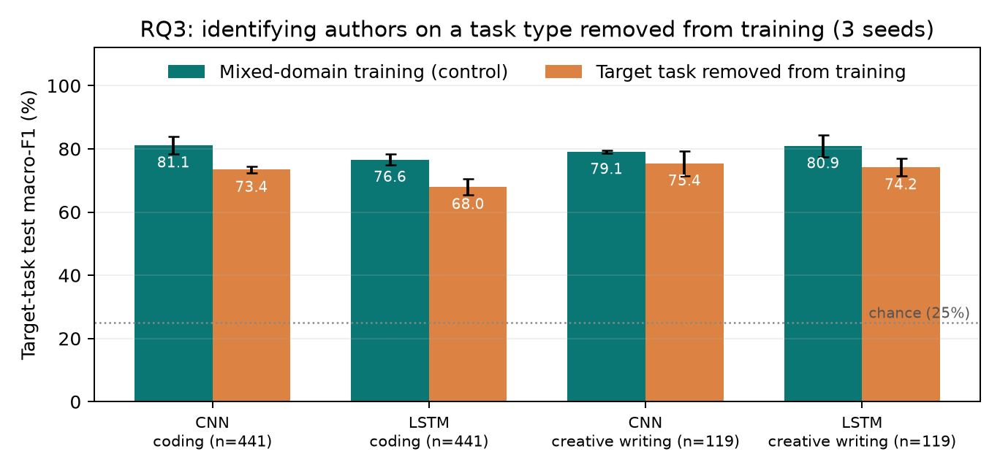
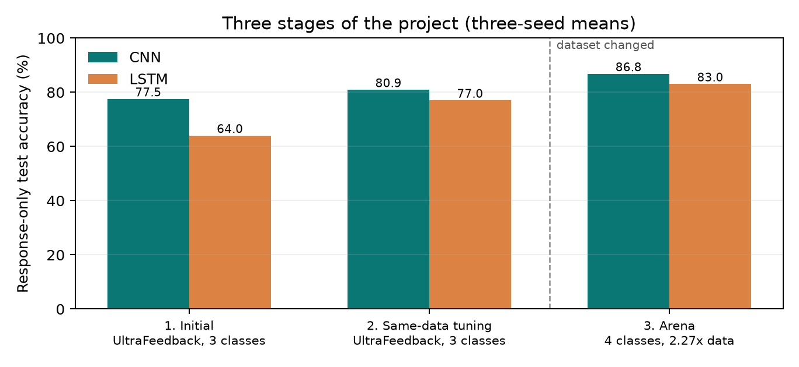
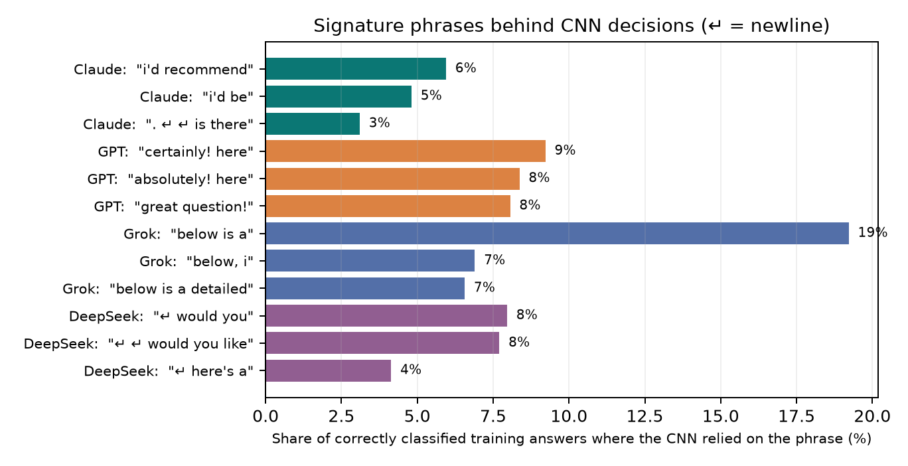

# Who Wrote It? Identifying LLMs from Their Responses

Identifying LLMs from Their Responses

Haodong Huang | Individual projectCMPSC 448 | October 11, 2026

### Abstract

This project asks whether a neural classifier can tell which LLM wrote a response. From a pinned Arena Human Preference 140k release I curate 9,643 English, single-turn responses from four fixed releases (Claude Sonnet 4, GPT-4.1, Grok 3, DeepSeek V3), with model names masked and no prompt or session shared across splits. A validation screen selects one CNN and one LSTM recipe, each trained with three seeds on prompt-only, response-only, and combined input. Response-only macro-F1 is 86.5% for the CNN and 82.5% for the LSTM; prompts alone are near chance, and adding them does not help. Follow-up experiments show that accuracy keeps rising with training data, survives when length is hidden and when two models answer the identical prompt, comes mainly from how responses open, and largely transfers to task types removed from training. An equal-weight ensemble with character TF-IDF reaches 89.5% (88.5% with validation-chosen weights). The results describe four specific releases, not universal authorship attribution.

### Where to find each grading criterion

| Rubric criterion | Sections |
| --- | --- |
| Problem definition and dataset curation | 1 (data and provenance), 2 (splits and leakage control) |
| CNN/RNN implementation and training | 3 (architectures), 4 (training and model selection) |
| Results and presentation | 5 (main results), 6 (per-class errors), 7 (prompt effect) |
| In-depth analyses and experiments | 8 (RQ3 domain transfer), 9-10 (RQ4 signals), 11 (follow-up experiments), 12 (checks) |
| Lessons and experience learned | 14 (also 13: how the project evolved) |

### Research questions and evidence

| Question | Evidence |
| --- | --- |
| RQ1: Identify the author? | CNN accuracy 86.8%; LSTM accuracy 83.0%. Macro-F1 and class recall accompany accuracy. |
| RQ2: Does the prompt help? | Combined-minus-output macro-F1: CNN -0.33 pp; LSTM -1.73 pp. Follow-up: on 76 identical-prompt pairs the CNN assigns both authors correctly 99.1% of the time. |
| RQ3: Transfer to new tasks? | Without coding in training, CNN coding F1 falls from 81.1% to 73.4%; without creative writing (the assignment's example), from 79.1% to 75.4%. Both far above 25% chance. |
| RQ4: Which signals matter? | Word-only normalization, structural classifiers, equal-length inputs (CNN 81.9% F1 with length hidden), window position, and the n-grams the CNN relies on. |

## 1. Dataset and model provenance

The official Arena release contains 135,634 battles collected in April-July 2025 [1,2]. Each side provides a model ID and a conversation. We convert a retained side into (LLM_name, LLM_Input, LLM_output). Human preference votes are not author labels and never become input features. The source revision and seven file hashes are recorded in docs/arena_data_provenance.json.

| Class | Exact model ID | Before filters | Retained |
| --- | --- | --- | --- |
| Claude | claude-sonnet-4-20250514 | 8295 | 2774 |
| GPT | gpt-4.1-2025-04-14 | 6540 | 2388 |
| Grok | grok-3-preview-02-24 | 6040 | 2201 |
| DeepSeek | deepseek-v3-0324 | 6117 | 2280 |

One explicit, non-thinking model variant per family controls a major source of confounding. Grok 4 has only 1,561 sides in the complete release, whereas Grok 3 has 6,040; the study selects Grok 3 for sample support. Therefore class names are convenient abbreviations for these four fixed IDs. Later releases and alternative reasoning settings remain outside the measured scope.

### Curation sequence

| Rule | Reason |
| --- | --- |
| Exact four IDs; language=en | Keep the authorship target and language explicit. |
| evaluation_order=1; exactly user then assistant | Avoid attributing inherited or multi-model history to the current author. |
| Text-only content; prompt >=3 words, answer >=10 | Exclude multimodal records, empty outputs, and uninformative fragments. |
| Exclude email/API-key patterns and extreme lengths | Basic content screening; not a guarantee of complete de-identification. |
| Deduplicate identical prompt/model/answer triples | Avoid repeatedly counting an identical observation. |
| Mask provider and model-name strings in both fields | Reduce direct identity shortcuts. |

The four selected IDs contribute 26,992 sides before filtering; 9,643 remain. All eligible responses are retained rather than selecting easy examples. Identity masking affects 516 retained answers. Public artifacts contain no raw conversation text.

## 2. Splits, leakage controls, and scope

| Split | Responses | Groups | Claude / GPT / Grok / DeepSeek |
| --- | --- | --- | --- |
| Train | 6735 | 6216 | 1946 / 1668 / 1529 / 1592 |
| Val | 1442 | 1332 | 407 / 356 / 342 / 337 |
| Test | 1466 | 1332 | 421 / 364 / 330 / 351 |

Rows are linked by shared evaluation session, normalized prompt, or normalized exact answer. Character TF-IDF prompt similarity of at least 0.90 also links rows. Transitive connected components form 8,880 groups over 9,031 exact prompt IDs; the largest group contains 12 responses. GroupShuffleSplit uses seed 1448 for the 15% test-group split and 1449 for validation groups from the remainder. Ratios are approximate by response count because groups are indivisible.

Duplicate detection runs on the whole corpus but never sees labels or results. Everything a classifier learns from (vocabularies, TF-IDF features, scalers, class weights) is fitted on training data only, and an independent check confirms that no session, prompt, or duplicate group crosses splits.

### What enters each classifier?

| Included | Excluded |
| --- | --- |
| Masked question and/or answer tokens | Model ID, provider name metadata, timestamps |
| A training-only vocabulary | Human winner votes, category metadata |
| Observed punctuation and newline tokens | Dataset quality scores or hidden reasoning traces |

Arena shows each question to only two models, so the four authors do not answer the same set of prompts. Prompt-only accuracy is therefore not fixed at 25%; it measures how much the prompts alone reveal about the author.

Class balance is reasonably close but not exact. The test majority-class accuracy is 28.7%; uniform random accuracy is 25%, and an always-one-class predictor has 25% balanced accuracy. Macro-F1 is the primary model-selection metric.

Main study: 9,643 responses; four classes; 27 neural and 6 classical fits; 31 test prediction files; 2,000 group-bootstrap resamples. Section 11 adds 38 neural and 9 classical follow-up fits, reported separately from the main-study numbers. The earlier UltraFeedback study is kept separate and is not pooled into these scores.

## 3. CNN and LSTM implementation

Both models use randomly initialized trainable token embeddings. Tokenization lowercases text, preserves punctuation, and represents newlines explicitly. Training-only vocabularies contain at most 20,000 tokens, with PAD, UNK, and a separator. No pretrained LLM is used as a classifier. Chapter 4 supplies the convolution/pooling and recurrent-network concepts [3].

| Selected model | Embedding | Width | Answer tokens | Parameters |
| --- | --- | --- | --- | --- |
| CNN | 128-D | 96 | 384 | 2,708,900 |
| LSTM | 64-D | 64 | 192 | 1,347,588 |

### CNN: local patterns plus global pooling

Three 1-D convolutions have widths 3, 4, and 5. ReLU activates each feature map; global max pooling retains a strong occurrence anywhere in the valid sequence. A mask excludes padded windows. The pooled features are concatenated, passed through dropout, and projected into four logits. This structure can capture repeated phrases, punctuation patterns, and formatting cues without reading a response recurrently.

### LSTM: contextual states plus sequence pooling

The selected LSTM is bidirectional. It generates hidden states for each real token, then concatenates a masked mean and masked maximum over states. A dropout layer and linear layer output four logits. The bidirectional candidate uses separate forward and reversed valid-prefix LSTMs; padding is excluded when reversing and pooling. Its behavior is checked against packed PyTorch recurrence.

### Input conditions

| Condition | Token budget |
| --- | --- |
| Input only | First 96 question tokens |
| Output only | First 384 answer tokens for CNN; 192 for LSTM |
| Input + output | 96 question tokens + separator + the full architecture-specific answer budget |

The CNN reads more answer tokens than the LSTM, so CNN versus LSTM compares complete recipes, not architectures alone. Within each architecture, all three input conditions use the same answer budget.

## 4. Training and frozen model selection

Training minimizes class-weighted cross-entropy using Adam (learning rate 0.001, weight decay 0.0001), gradient norm clipping at 1.0, batches of 128, embedding dropout 0.10, and model dropout 0.30 or 0.40. The class weight is N/(4*n_class), calculated only on the training subset. These choices build on Chapter 9 optimization concepts [4].

Each fit runs at most 20 epochs, with early stopping after four epochs without improvement. Checkpoints maximize validation macro-F1, then minimize validation loss to break a tie. The test set is not loaded during training or configuration selection. A pre-evaluation masking repair removed three release suffixes; all reported fits use the corrected text and regenerated split. Four response-only candidates are screened at seed 1448:

| ID | Architecture / change | Validation F1 | Selected |
| --- | --- | --- | --- |
| c1 | CNN; emb 64, width 64 | 86.4% | No |
| c2 | CNN; emb 128, width 96 | 87.0% | Yes |
| r1 | LSTM; emb 64, width 64 | 81.0% | No |
| r2 | LSTM; emb 64, width 64; bidirectional | 82.7% | Yes |

The winning recipe for each architecture is repeated at seeds 1448, 1449, and 1450 for question-only, answer-only, and combined inputs. Selected recipes also receive seed-1448 diagnostic fits. All neural and classical checkpoints are hashed before any test evaluation; rejected candidates receive no test scores.

Validation curves for the selected response-only seed-1448 runs. Checkpoint selection uses these curves, not test scores.

The screen uses one seed and four candidates, so it is a small search; the three-seed final runs show how much results vary between trainings.

## 5. Main results: RQ1 and RQ2

| Model / input | Accuracy | Macro-F1 | Balanced acc. | F1 seed SD |
| --- | --- | --- | --- | --- |
| CNN / input | 26.9% | 26.3% | 26.7% | 0.36 pp |
| CNN / output | 86.8% | 86.5% | 86.5% | 0.39 pp |
| CNN / combined | 86.5% | 86.2% | 86.2% | 1.12 pp |
| LSTM / input | 25.1% | 24.1% | 25.2% | 1.63 pp |
| LSTM / output | 83.0% | 82.5% | 82.6% | 0.85 pp |
| LSTM / combined | 81.2% | 80.8% | 81.0% | 0.35 pp |

Bars: means over three seeds. Error bars: 95% percentile intervals from 2,000 resamples of held-out session/duplicate groups.

For response-only attribution, the CNN-minus-LSTM macro-F1 difference is +3.98 pp; 95% CI [2.52, 5.42] The interval excludes zero. Both architectures are evaluated against the same rows and grouped resampling draws.

The intervals capture uncertainty from which test questions happened to be sampled; they do not cover retraining, model selection, or future model releases.

## 6. Errors and per-class performance

Response-only confusion matrices, pooled over three seeds and normalized by true class. Every row sums to 100%.

| True class | CNN recall | LSTM recall | Test support |
| --- | --- | --- | --- |
| Claude | 92.7% | 91.6% | 421 |
| GPT | 86.4% | 83.3% | 364 |
| Grok | 86.0% | 84.4% | 330 |
| DeepSeek | 80.9% | 71.1% | 351 |

Claude is the easiest author to recognize (CNN recall 92.7%). DeepSeek is the hardest: the LSTM recognizes 71.1% of its answers and labels 14.5% of them GPT. GPT and DeepSeek are the most confused pair in both directions for both models, so their styles are the most alike in this data.

### Descriptive task slices

| Model | Coding F1 | Non-coding F1 |
| --- | --- | --- |
| CNN | 82.5% | 88.4% |
| LSTM | 79.2% | 84.0% |

These slices use models trained on mixed tasks. They are descriptive performance breakdowns, not evidence of generalization to an unseen domain. The next domain-transfer experiment specifically removes coding tasks from training.

## 7. Does the question help?

### CNN

Question-only macro-F1 is 26.3%, response-only is 86.5%, and combined is 86.2%. The paired combined-minus-response difference is -0.33 pp; 95% CI [-1.44, 0.78] The interval includes zero; the direction is not resolved.

### LSTM

Question-only macro-F1 is 24.1%, response-only is 82.5%, and combined is 80.8%. The paired combined-minus-response difference is -1.73 pp; 95% CI [-2.89, -0.54] The interval excludes zero.

### How to interpret input-only prediction

Prompt-only accuracy is near chance. The prompt is written before the model answers, so whatever it reveals cannot be the model's fingerprint; any residual signal can only come from which prompts each model happened to receive. For example, Claude Sonnet 4 first appears in this data on May 22, 2025, so it never answered April prompts.

Adding the prompt to the answer does not help: for the CNN the change is within noise, and for the LSTM it slightly hurts, plausibly because the extra tokens dilute the answer signal. Section 11C tests the prompt question directly with pairs of answers to the identical prompt.

### Classical prompt check

The fixed word TF-IDF question-only baseline achieves 27.4% accuracy and 27.3% macro-F1. It offers an independent check for prompt information with a different representation.

The answer prefix is unchanged when the question is added: combined input concatenates the 96-token question, a separator, and the same 384-token CNN or 192-token LSTM answer prefix. Thus a change in score is not caused by truncating away the answer to make room for the question.

## 8. Cross-task generalization: RQ3

A non-coding training subset excludes all rows with Arena is_code=true. Both domain-transfer models validate on non-code rows only. A mixed-domain control uses exactly the same number of training examples in each class, sampled from the original training split. Both are evaluated on the identical coding subset of the untouched test split. This separates the loss of coding exposure from a simple reduction in training size.

| Model / training | Train rows | Coding accuracy | Coding F1 |
| --- | --- | --- | --- |
| CNN / holdout | 4626 | 74.6% | 74.5% |
| CNN / control | 4626 | 81.9% | 82.3% |
| LSTM / holdout | 4626 | 71.4% | 70.7% |
| LSTM / control | 4626 | 75.1% | 75.0% |

CNN: non-code-minus-control coding macro-F1 is -7.78 pp, with paired 95% group-bootstrap interval [-11.00, -4.58]. Coding test support is 441 responses.

LSTM: non-code-minus-control coding macro-F1 is -4.34 pp, with paired 95% group-bootstrap interval [-8.62, -0.45]. Coding test support is 441 responses.

Without any coding examples, both models still identify authors on coding prompts far above chance, so part of the fingerprint transfers. The drop against the control shows that seeing the task type in training still helps. Arena's code label is only a proxy for domain, so this is evidence of partial transfer, not of a universal fingerprint.

This main-study version uses one seed, and the architecture recipes come from the mixed-domain screen, so coding was not completely unseen during design. Section 11F repeats it with three seeds and adds a second domain, the assignment's own example: training without creative writing and testing on it.

## 9. Fingerprint signals: RQ4

| Baseline | Test accuracy | Macro-F1 |
| --- | --- | --- |
| word input | 27.4% | 27.3% |
| word output | 79.4% | 79.1% |
| word combined | 79.1% | 78.7% |
| char output | 87.7% | 87.3% |
| style all | 65.3% | 64.4% |
| style no length | 64.3% | 63.2% |

The character baseline reaches 87.7% accuracy and 87.3% macro-F1, a slightly higher point estimate than the CNN mean. This highlights the strength of local lexical patterns; the small ranking difference alone does not establish reliable superiority.

Word TF-IDF uses 1-2 grams; character TF-IDF uses 3-5 grams. Each is capped at 40,000 features, min_df=3, with sublinear term frequency and balanced logistic regression (C=2). Text baselines use the first 96 question and/or 384 answer tokens. This is a longer answer budget than the LSTM's. All transforms are fitted on training data.

Structural baselines use full-answer statistics: log character/word counts, average word length, lexical diversity, newline/punctuation/digit/uppercase rates, list-line rate, and code-fence count. The no-length variant removes the two explicit log length features; other features can still correlate with length. These diagnostics are not controlled equal-input-budget competitors.

### Remove punctuation and newline information

| Model | Raw answer F1, seed 1448 | Word-only F1 | Difference |
| --- | --- | --- | --- |
| CNN | 86.2% | 78.6% | -7.61 pp |
| LSTM | 81.6% | 66.3% | -15.29 pp |

CNN normalization contrast: -7.61 pp; 95% CI [-9.78, -5.39]

LSTM normalization contrast: -15.29 pp; 95% CI [-18.07, -12.51]

Removing punctuation and newlines costs the CNN 7.6 points and the LSTM 15.3. Because the word-only version also fits more words into the same token budget, this measures the value of formatting tokens as a group, not of any single feature.

## 10. Structural profiles and interpretation

The following summaries use training responses only. They describe the curated distribution, rather than selecting examples after seeing test errors. Medians are robust summaries but conceal substantial within-class variation.

| Source | Median words | Lexical diversity | Newline / 1k chars | Punctuation / 1k chars |
| --- | --- | --- | --- | --- |
| Claude | 210 | 0.636 | 11.2 | 41.9 |
| GPT | 323 | 0.509 | 20.3 | 108.5 |
| Grok | 813 | 0.375 | 12.2 | 73.2 |
| DeepSeek | 312 | 0.567 | 17.4 | 110.2 |

Here a word is a regex word token, lexical diversity is unique lowercased words divided by all words, and character rates are measured on the full masked answer. These word counts differ from whitespace counts used in the raw curation audit and from the neural tokenizer.

Response length is itself a source signal: Grok's median answer is about four times as long as Claude's. Truncation limits how much the networks read, but a short answer still reveals its length through how many real tokens it has. Section 11B tests this directly by giving the models inputs of identical length.

### What the analyses establish

Word and character patterns alone are enough to identify authors well (char TF-IDF 87.7%). A handful of formatting and length summaries reaches 65.3%. Removing punctuation and newlines hurts both networks. None of these shows the network's internal decision rule directly; Section 11D traces the CNN's decisions to specific phrases.

### What would strengthen a later study?

A future independent experiment could collect the same prompts from all four models under matched generation settings and hold out newer model versions. Section 11 takes first steps with equal-length inputs and the identical-prompt pairs Arena already contains. That would separate provider, prompt distribution, generation settings, and length more directly. Such follow-up work needs a new evaluation set, because this test set has now been used for the reported study.

## 11. Follow-up experiments after the main evaluation

The main study above was frozen and evaluated once. This section asks four questions the main study left open: does more training data help, is the classifier only reading answer length, does the fingerprint survive when the prompt is identical, and where in an answer does it live? Part F then extends RQ3. The fractions, seeds, and ensemble rule were fixed in code and recorded in docs/arena_followup_plan.json before the runs, and no configuration was chosen using test labels. Because the test split had already been seen, these are follow-up analyses, not a second confirmation. One disclosure: the length strata and matched-pair counts were previewed from saved predictions before the plan was written; nothing was changed as a result.

### A. Learning curve: does more training data help?

| Training responses | CNN macro-F1 | LSTM macro-F1 | Char TF-IDF macro-F1 |
| --- | --- | --- | --- |
| 841 (12.5%) | 75.6% ± 2.1 | 66.0% ± 0.7 | 77.6% ± 1.0 |
| 1,683 (25%) | 80.2% ± 0.8 | 71.3% ± 0.4 | 79.6% ± 0.4 |
| 3,367 (50%) | 83.0% ± 1.1 | 77.4% ± 1.6 | 83.5% ± 0.3 |
| 6,735 (100%) | 86.5% ± 0.4 | 82.5% ± 0.8 | 87.3% |

Selected CNN/LSTM recipes and the char TF-IDF baseline retrained on class-stratified subsets of the same training split; validation and test are unchanged. Points: mean ± SD over seeds 1448-1450 (the full-data char baseline is a single fit).

Going from one eighth of the training data to all of it adds 10.9 points of macro-F1 for the CNN, 16.5 for the LSTM, and 9.7 for char TF-IDF. No curve has flattened at the right edge, so more data would likely help further. The CNN tracks char TF-IDF closely at every size, while the LSTM, which learns its sequence representation from scratch, gains the most from data and is still well behind at full size. This is the experiment Section 13 needed: within one fixed task, more examples did improve attribution.

### B. Is the classifier just measuring length?

Grok answers are long (median about 1,480 neural tokens in test) and Claude answers short (about 300), so a model could in principle count padding. Two checks argue against length as the main cue. First, on answers of at least 384 tokens, where the CNN window is completely full and contains no padding, CNN macro-F1 is 86.9% (887 answers). Second, the frozen models were re-run with every test answer cut to exactly its first 128 tokens, dropping the 126 shorter answers, so all inputs have identical length: CNN 81.9%, LSTM 82.1%, char TF-IDF 81.2% macro-F1.

Response-only macro-F1 by answer length (CNN and LSTM: three-seed means). Short answers are hardest: they carry fewer distinctive tokens.

About 82% macro-F1 with length hidden is lower than the full-input score, so length and later tokens carry some signal, but most of the attribution survives without them.

### C. Same prompt, two authors (RQ2)

For 76 test battles both responses survived curation, giving identical prompts answered by two different models. A prompt-only classifier cannot separate them: the CNN prompt-only model scores exactly 50.0% on the pairwise task. Given the two answers and the two candidate authors, the response-only CNN assigns them correctly 99.1% of the time (LSTM 99.1%, char TF-IDF 100.0%); the CNN labels both sides correctly among all four classes 82.0% of the time. With the topic held fixed, the answer still identifies its author. The sample is small, so treat these as a direction rather than a precise rate.

### D. Where is the fingerprint? (RQ4)

| 192-token window | CNN macro-F1 | LSTM macro-F1 |
| --- | --- | --- |
| First | 82.3% | 81.6% |
| Middle | 62.0% | 52.9% |
| Last | 75.3% | 63.8% |

On the 673 test answers of at least 576 tokens, frozen models read a first, middle, or last 192-token window. Accuracy is highest on the opening, collapses in the middle, and partly recovers at the end. Both models were trained on answer prefixes, which favors the first window. Neither was trained specifically on endings; they saw sign-offs only in answers short enough to fit their window. That the last window still recovers suggests sign-offs such as "Would you like…" are distinctive. Claude has only 54 answers this long.

| Author | Most decisive CNN n-grams (training answers, share of correctly classified answers) |
| --- | --- |
| Claude | . ↵ ↵ ** (25%); ↵ ↵ the (16%); i'd recommend (6%); ↵ ↵ what (5%); i'd be (5%); ` ↵ ↵ ** (3%) |
| GPT | --- ↵ ↵ (25%); certainly! here (9%); ↵ ## * (9%); absolutely! here (8%); great question! (8%); certainly! here ’ (7%) |
| Grok | ### 1 (19%); below is a (19%); ↵ 1. * (7%); below, i (7%); below is a detailed (7%); below, i ’ (5%) |
| DeepSeek | ### (56%); ## ** 2 (24%); ## ** 3 (14%); * ↵ 1. (12%); ↵ would you (8%); ↵ ↵ would you like (8%) |

For each correctly classified training answer, the five convolution filters that push hardest toward the true class were traced back to the n-gram at their max-pooled position. Shown are n-grams appearing for at least 15 answers and at least 60% of the time for one class (↵ is a newline). The pattern is readable: GPT opens with "Certainly! Here's", "Absolutely! Here's", or "Great question!"; Grok with "Below is a detailed…"; Claude says "I'd recommend" and closes by asking a question ("Is there…? That would help"); DeepSeek uses bolded numbered headers and closes with "Would you like…". The fingerprint is largely conversational framing and Markdown habits, which explains why the opening window is most informative and why removing punctuation and newlines (Section 9) costs so much.

### E. Two more checks

Identity placeholder. Removing the 71 test answers that contain a [MODEL] mask leaves CNN macro-F1 at 86.2% and LSTM at 82.3%, essentially unchanged, so masked self-references are not a shortcut.

Ensemble. Averaging the probabilities of the CNN (three seeds), the LSTM (three seeds), and char TF-IDF combines different views of the text. Weights chosen on validation (CNN 0.55, LSTM 0.35, char 0.10) reach 88.5% test macro-F1, +1.14 pp over char TF-IDF, 95% CI [-0.45, 2.79]. The pre-specified equal-weight average reaches 89.5%, +2.15 pp, CI [0.67, 3.65]. Validation-tuned weights did not beat the simple average here, a reminder that 1,442 validation answers make weight tuning noisy. The equal-weight result suggests the CNN and LSTM capture information that char TF-IDF misses; the validation-weighted interval includes zero, so the size of that gain is uncertain.

### F. RQ3 extended: three seeds and the assignment's writing example

Section 8 ran one domain split with one seed. Here the coding holdout is repeated with seeds 1449 and 1450 (seed 1448 is the frozen main-study fit), and a second split follows the assignment's own example: train on everything except creative writing, so coding, math, factual, and other prompts remain, and test on creative writing. Each holdout is compared with a mixed-domain control of identical per-class training size, sampled from the full training split. This extension was planned in docs/arena_followup_domain_plan.json and committed to Git before any of its models were trained.

| Test task (rows) | Model | Control F1 | Holdout F1 | Holdout minus control [95% CI] |
| --- | --- | --- | --- | --- |
| Coding (441) | CNN | 81.1% ± 2.7 | 73.4% ± 1.1 | -7.73 pp [-10.55, -5.18] |
| Coding (441) | LSTM | 76.6% ± 1.8 | 68.0% ± 2.5 | -8.64 pp [-11.56, -5.78] |
| Creative writing (119) | CNN | 79.1% ± 0.5 | 75.4% ± 3.9 | -3.67 pp [-7.74, 0.24] |
| Creative writing (119) | LSTM | 80.9% ± 3.5 | 74.2% ± 2.8 | -6.69 pp [-12.07, -2.07] |

Target-task test macro-F1, mean ± SD over seeds 1448-1450. Control: mixed-domain training of the same per-class size. Holdout: the target task type removed from training and validation.

Removing a task type from training costs about 4 to 9 points of macro-F1 on that task. The drop is clear for both models on coding and for the LSTM on writing; for the CNN on writing the interval reaches zero, with only 119 test answers. Yet every holdout model stays far above the 25% chance level. Most of the fingerprint is therefore general and carries over to an unseen task type, while a smaller part is task-specific. The three-seed coding results confirm the single-seed finding of Section 8, and the LSTM drop (-8.64 pp) is larger than its seed-1448 estimate (-4.34 pp), which shows why one seed is not enough.

| Author | Coding: control | Coding: holdout | Writing: control | Writing: holdout |
| --- | --- | --- | --- | --- |
| Claude | 84.8% | 83.5% | 96.6% | 98.3% |
| GPT | 84.8% | 78.9% | 71.6% | 75.5% |
| Grok | 80.8% | 78.6% | 78.9% | 77.2% |
| DeepSeek | 73.4% | 53.2% | 72.8% | 53.1% |

The table shows CNN recall by author (mean of three seeds); the LSTM shows the same pattern. This answers the assignment's question of whether some models are more consistently identifiable across domains: Claude stays recognizable on both unseen task types (83.5% on coding, 98.3% on writing, close to its control). DeepSeek loses the most, about 20 points on each task, so what separates it from the other authors depends more on having seen that kind of task. Per-author writing numbers rest on 19 to 39 test answers each.

## 12. Checks and limitations

The shuffled-training-label CNN has test accuracy 23.3% and macro-F1 21.8%. Labels are permuted only in training; validation and test labels remain unchanged. This is a pipeline sanity check, not a proof that all confounding is eliminated.

| Verified check | Evidence |
| --- | --- |
| Session, prompt, duplicate-group separation | Independent assertions across all splits |
| Validation-only model choice | 33 validation prediction files recomputed; selected IDs reproduced |
| Reported test scores | 31 prediction files independently rescored |
| Saved-model inference | CNN/LSTM checkpoint replay against stored probabilities |
| Implementation invariants | 16 unit tests: masking, attribution, vocabulary, padding, recurrent states, class count, follow-up subsetting and domain switching |

### Material limitations

The study uses one Arena snapshot, four releases, English first turns, and filtered nontrivial answers. It excludes later model generations, reasoning variants, multilingual text, multi-turn conversations, and multimodal inputs. Automatic identity masking cannot remove all semantic self-identification. Model-side prompts may differ by author; prompt-only controls measure part of this concern but cannot erase it.

Question or answer truncation may discard useful evidence. Softmax values are uncalibrated and should not be presented as trustworthy probabilities for arbitrary text. Future reuse of this test set for tuning would turn subsequent results into follow-up exploration, requiring another independent test for confirmation.

## 13. Project evolution and dataset choice

The project developed in three stages. Earlier code, measured results, and demonstration weights remain in the repository so that the final study can be traced back to its initial implementation. The table reports response-only accuracy, averaged over three seeds within each stage.

| Stage | Data / author classes | Responses | CNN | LSTM |
| --- | --- | --- | --- | --- |
| Initial implementation | UltraFeedback: Falcon, GPT, Llama | 4,254 | 77.52% | 64.01% |
| Same-data optimization | Same UltraFeedback data and split | 4,254 | 80.91% | 77.00% |
| Current study | Arena: Claude, GPT, Grok, DeepSeek | 9,643 | 86.79% | 83.04% |

### Why change the dataset?

1. More recognizable model families. I wanted to study Claude, GPT, Grok, and DeepSeek. Arena contains identifiable releases from all four, which makes the target authors more relevant than the original Falcon/GPT/Llama subset. The selected records are from 2025, not the latest 2026 releases.

2. More usable examples. After curation, the sample increases from 4,254 to 9,643 responses (2.27 times as many). The motivation was to give the models more training evidence and test whether performance could improve. The dataset name "140k" describes the source release, not the number of responses used for training.

### What improved, and what can we conclude?

On the same UltraFeedback task and split, bounded validation search, a longer CNN answer budget, and pooled LSTM states produced accuracy gains of 3.39 and 12.99 percentage points respectively. This was exploratory follow-up after the original test results had been seen, rather than a new independent confirmation.

The Arena study adds a four-class target, explicit release selection, session/near-duplicate grouping, a frozen validation screen before test evaluation, and matched-size domain controls. Its higher accuracy is an observed result on a different task. Changes in author classes, text distribution, and split design prevent attributing the difference to sample size. The follow-up learning curve in Section 11 isolates training size on the fixed Arena split: with the same recipes, validation set, and test set, CNN macro-F1 rises from 75.6% with 841 training responses to 86.5% with 6,735. More examples did help within Arena; the curve still says nothing about the cross-dataset jump.

## 14. Lessons and experience learned

This section is written from my own notes on the project. The earlier sections report what was measured; this one reports what I learned while measuring it, what surprised me, what went wrong and how it was fixed, and what I would do differently. Every number below comes from the saved result files used in the rest of the report.

### Lessons at a glance

| # | Lesson | Evidence in this project |
| --- | --- | --- |
| 1 | The dataset sets the ceiling. | Same-data tuning took the LSTM from 64.0% to 77.0%; only a new dataset moved it past 80%. |
| 2 | More data beat more difficulty. | Four classes instead of three, yet the LSTM reached 83.0%. At the old training size it sits near the old 77% plateau. |
| 3 | Always run a cheap baseline. | Char TF-IDF (87.3% F1) edged out the CNN (86.5%); an equal-weight combination gave 89.5%. |
| 4 | The fingerprint is in the framing. | Openers such as "Certainly! Here's" and "Below is a detailed" drive decisions; the first window is easiest. |
| 5 | Choose the data before the model. | Arena covers mainstream, actively updated models; Falcon-era data could not grow. |
| 6 | Test for shortcuts before trusting a score. | Length, identity-mask, and same-prompt controls in Section 11 all held up. |

### 1. The data limited the first version more than the model did

The hardest part of the project was the first version. On UltraFeedback (Falcon, GPT, Llama; 4,254 usable responses) the LSTM reached only 64.0% accuracy. I spent the second stage improving the model on the same data: a bounded validation search over twelve candidates, a longer CNN input, and LSTM pooling. That lifted the LSTM to 77.0% and the CNN to 80.9%, but I could not find a way past that level. I also could not simply add examples, because public datasets that contain those same model releases barely exist, especially for Falcon. To make a real breakthrough I had to change the dataset and essentially start again on Arena.

Response-only test accuracy at each stage (three-seed means). Stages 1-2 share one dataset and three classes; stage 3 is a different, four-class task, so the jump is not a controlled comparison.

The lesson is that the dataset sets the ceiling. It decides how many examples exist, which authors can be studied, and therefore how far any later tuning can go. Model work in stage 2 was still valuable, since it is where I learned how much pooling matters for an LSTM, but it could not compensate for a small, fixed dataset.

### 2. More classes, yet higher accuracy

I expected four authors to be harder to separate than three, since chance accuracy drops from 33% to 25%. Instead, accuracy went up: the LSTM reached 83.0% and the CNN 86.8%, close to 90%. I believe a large part of the reason is simply more data. The follow-up learning curve tests this within Arena, holding the task, recipe, validation set, and test set fixed and changing only the number of training answers.

Arena learning curve in test accuracy (three-seed means). Dotted lines mark where the UltraFeedback LSTM stopped and the dashed line marks the UltraFeedback training size. UltraFeedback is a different three-class task, so these marks are a visual reference, not a controlled comparison.

The first version trained on 2,976 answers. At a similar size, 3,367 Arena answers, the Arena LSTM reaches 77.9% accuracy, about where the tuned UltraFeedback LSTM stopped (77.0%), even though the Arena task has four classes instead of three. With all 6,735 answers it reaches 83.0%. This splits the story in two. The very first version's 64.0% came mainly from the LSTM design, which read only the final hidden state; stage 2 fixed that. What then held the LSTM near 77% was the amount of training data. Had I stayed with a dataset of the old size, I would very likely still be stuck there. The two datasets also differ in authors and prompts, so data size is a strong explanation but not the only one.

### 3. Assumptions versus what happened

| A natural assumption | What actually happened | Takeaway |
| --- | --- | --- |
| Four classes would be harder than three. | Accuracy rose to 86.8% (CNN). | Sample size can matter more than task difficulty. |
| A deep model would beat a classical one. | Char TF-IDF scored 87.3% F1 vs. CNN 86.5%. | Always measure against a cheap baseline. |
| Adding the prompt would help. | Combined input changed F1 by -0.33 pp (CNN) and -1.73 pp (LSTM). | The answer alone carries the fingerprint. |
| Models would be told apart by content. | Openers, sign-offs, and Markdown habits drive decisions. | Style of presentation is the main signal. |
| Long Grok answers might make length a shortcut. | Equal 128-token inputs still give 81.9% CNN F1. | Length helps a little, but is not the main cue. |
| Fingerprints would not survive a new task type. | Trained without coding or writing, CNN F1 on those tasks is 73.4% and 75.4%. | Most of the fingerprint is general; a smaller part is task-specific. |
| The LSTM would read text better than the CNN. | The CNN led by +3.98 pp F1. | Local n-gram detectors suit this task well. |

The baseline surprise was the most useful one. Character TF-IDF with logistic regression trains in seconds, yet it slightly outscored my CNN. A deep model is not automatically better than a well-chosen classical one. The two are complementary, though: averaging the CNN, LSTM, and TF-IDF probabilities with equal weights reached 89.5% macro-F1, the best result in the project (88.5% with validation-chosen weights).

### 4. The fingerprint is in how a response starts

The third surprise was where the evidence lives. When I traced the CNN's decisions back to the phrases that triggered them, they were mostly about how the model frames a response rather than what it says.

Phrases at the max-pooled positions of the CNN filters that push hardest toward the correct author, on correctly classified training answers (Section 11D method; phrases with at least two words).

GPT opens with enthusiasm ("Certainly! Here's", "Great question!"), Grok announces structure ("Below is a detailed…"), Claude gives a personal recommendation and asks a follow-up ("I'd recommend", "Is there…"), and DeepSeek offers more help ("Would you like…"). This matches the window experiment: identification is easiest on the first 192 tokens and hardest in the middle of a long answer. What I learned is that an LLM "fingerprint" in this data is mostly a habit of presentation, which also suggests it could change quickly when providers update their models.

### 5. Was switching to Arena worth it?

|  | UltraFeedback (stages 1-2) | Arena (stage 3) |
| --- | --- | --- |
| Authors | Falcon, GPT, Llama | Claude, GPT, Grok, DeepSeek |
| Relevance | Older or less widely used models | Mainstream models that keep releasing new versions |
| Usable responses | 4,254 | 9,643 |
| Room to grow | Few datasets contain the same releases | Large public release with exact model IDs |

Looking back, switching was definitely worth it. ChatGPT, Claude, and Grok are used far more than Falcon, so studying them answers a question about text people actually read today. A reminder for my future self: before starting, search for the best and most current dataset for the question and understand what it contains, instead of picking a dataset more or less at random and starting work right away.

### 6. Mistakes, risks, and how they were fixed

| Problem or risk | How it was noticed | Fix | Result |
| --- | --- | --- | --- |
| LSTM summarized the answer with only its final hidden state. | Weak LSTM scores in stage 1. | Masked mean and max pooling over all real tokens. | LSTM 64.0% to 77.0%. |
| Stage-2 tuning happened after seeing stage-1 test scores. | Reviewing the protocol. | Stage 2 labelled exploratory; Arena selection frozen on validation before any test access. | Clean main study. |
| Three answers still contained model-version suffixes after masking. | Audit before test evaluation. | Masking repaired; every fit rerun from scratch. | No identity strings left. |
| Near-duplicate prompts could leak across splits. | Popular prompts recur across Arena battles. | Group by session, prompt, answer, and TF-IDF similarity of at least 0.90. | No group crosses splits. |
| The classifier might just count answer length. | Grok answers are about five times longer than Claude's. | Equal 128-token inputs; length strata. | CNN still 81.9% F1. |
| [MODEL] placeholders might act as a shortcut. | Placeholder rates differ slightly by class. | Score answers without any placeholder. | CNN 86.2% F1, unchanged. |

Most of these were not visible in the accuracy number. A model can score well for the wrong reason, so each risk needed its own targeted check. Writing the plan and freezing the model choice before looking at test results also turned out to matter: once a test set has been seen, every later change becomes exploratory.

### 7. What I would change if I started again

| Step | What I would do | Why |
| --- | --- | --- |
| 1 | Search for the best, most current dataset and read its documentation first. | The dataset sets the ceiling (Lessons 1, 2, 5). |
| 2 | Write down the split, metric, and test policy before training. | Avoids test reuse and leakage (Lesson 6). |
| 3 | Start with the simplest approach: a TF-IDF baseline. | Shows how strong simple patterns are (Lesson 3). |
| 4 | Work up to the CNN and then the LSTM, comparing each with the step before. | Every gain from complexity becomes visible. |
| 5 | Run shortcut checks (length, identity, same prompt) early. | Confirms the model learns style, not artifacts. |

## 15. Reproduction

Install Python 3.12 and the exact dependencies in requirements-lock.txt. The recorded runs use PyTorch 2.14.1 with Apple MPS. CPU inference replay verifies the two distributed demonstration weights; training on other devices can yield numerical differences.

| Step | Command |
| --- | --- |
| Download pinned data | python src/arena_data.py download |
| Create the fixed split once | python src/arena_data.py prepare |
| Screen, select, and fit core models | python src/arena_train.py train |
| Fit planned domain-transfer checks | python src/arena_train.py domain |
| Evaluate frozen models | python src/arena_train.py evaluate |
| Verify metrics and build figures | python src/arena_analyze.py |
| Run implementation checks | python -m unittest discover -s tests -v |
| Follow-up plan, diagnostics, learning curve, RQ3 extension | python src/arena_followup.py plan | posthoc | curve | domain |
| Lessons figures | python src/build_lessons_figures.py |
| Build this report | python src/build_report.py |

Run the commands in this order in a fresh clone. The two seed-1448 response-only models (CNN and LSTM) are included for demonstration; all other checkpoints can be regenerated with these commands.

Training and validating all main-study models took 12.5 minutes in total on Apple MPS, not counting the roughly 1.61 GB data download.

## Appendix. Sources and audit trail

[1] Arena Team. Arena Human Preference 140k.

https://huggingface.co/datasets/lmarena-ai/arena-human-preference-140k

[2] Arena Team. A Deep Dive into Recent Arena Data.

https://arena.ai/blog/opendata-july2025

[3] CMPSC 448. Chapter 4: Deep Learning Architectures.

Supplied lecture: convolution, pooling, recurrent networks, and LSTM.

[4] CMPSC 448. Chapter 9: ML Training--Gradient descent.

Supplied lecture: loss functions, mini-batches, and Adam.

[5] CMPSC 448. Who Wrote It? Identifying LLMs from Their Responses.

Assignment modified September 17, 2026; deadline October 11, 2026, 11:59 pm.

[6] PyTorch and scikit-learn API documentation.

https://pytorch.org/docs/stable/ ; https://scikit-learn.org/stable/

### Immutable source revision

6322995ab34d7c2693e3f47dd13fa5caa0789a74

The official dataset card licenses user prompts under CC-BY-4.0 and states that model outputs are governed by the respective providers' terms. The repository references the source and reproduces acquisition without redistributing raw conversation text.

| Artifact | Contents |
| --- | --- |
| docs/arena_data_provenance.json | Seven pinned URLs, file sizes, and SHA-256 hashes |
| data/arena/split_manifest.json | Non-text IDs, model labels, and fixed group assignments |
| docs/arena_experiment_plan.json; arena_selection.json | Candidates and the validation-selected configuration freeze |
| docs/arena_domain_plan.json; arena_training_complete.json | Domain protocol and checkpoint hashes before test access |
| results/arena/run_ledger.csv | Every fit, validation score, test score if evaluated, and time |
| results/arena/predictions/; verification.json | Non-text predictions, full score audit, and checkpoint replay |

Repository: https://github.com/DonDuckDuck/cmpsc448-llm-identification
